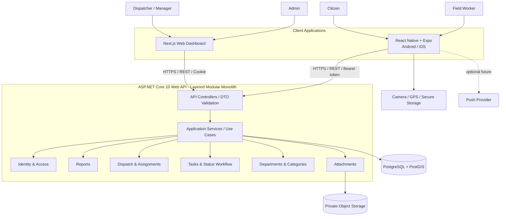
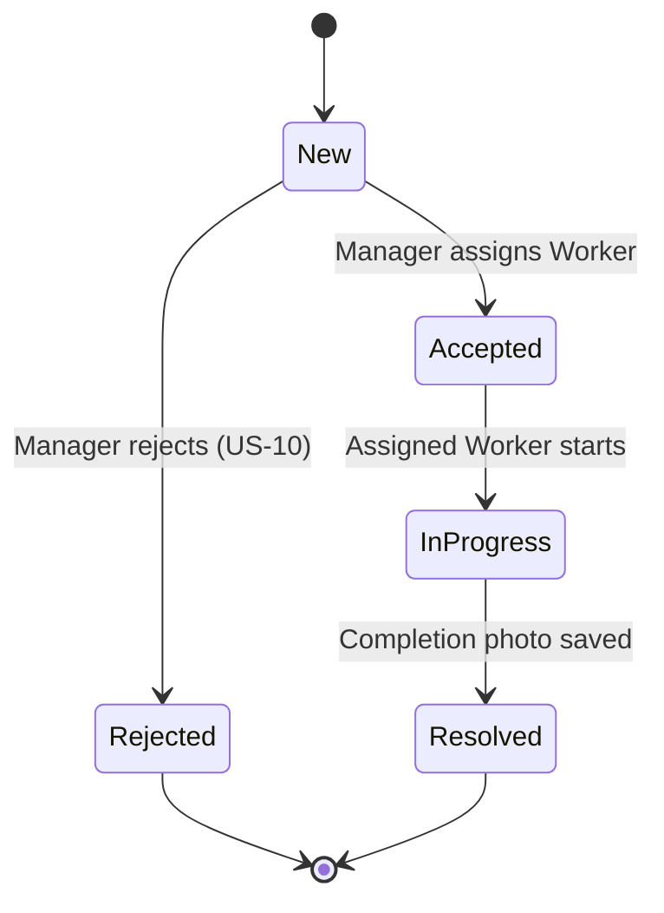

# FixIt — Software Architecture

**Overall Architecture:** Client–Server  
**Backend Architecture:** Layered Modular Monolith  
**Mobile:** React Native + Expo + TypeScript  
**Web Dashboard:** Next.js App Router + TypeScript  
**Backend:** ASP.NET Core 10 Web API  
**Database:** PostgreSQL + PostGIS

## 1. არქიტექტურული გადაწყვეტილება

FixIt-ს აქვს ორი განსხვავებული კლიენტი, რომლებიც ერთ Backend-ს იყენებენ. მოქალაქე და საველე თანამშრომელი ძირითადად ტელეფონით მუშაობენ: მათ სჭირდებათ კამერა, GPS, რუკა და ადგილზე დავალების განახლება. დისპეჩერსა და ადმინისტრატორს კი სჭირდებათ დიდი ეკრანის ცხრილები, ფილტრები და მართვის ფორმები. ამიტომ ერთ Responsive Web UI-ზე დაყრდნობის ნაცვლად ვირჩევთ Native Mobile App-ს და ცალკე Web Dashboard-ს.

Backend არის ერთი deployable ASP.NET Core Web API აპლიკაცია, რომლის შიდა პასუხისმგებლობები ფენებად და ბიზნესმოდულებად არის გამოყოფილი (Layered Modular Monolith).

### რატომ ეს არქიტექტურა?

1. **მომხმარებლის საჭიროება:** Citizen-სა და Worker-ს სჭირდებათ კამერა, GPS და სწრაფი საველე სამუშაო; React Native + Expo უზრუნველყოფს Android/iOS აპლიკაციას. Dispatcher/Admin-ის ცხრილური სამუშაო Next.js Web Dashboard-ზე უფრო მოსახერხებელია.
2. **ერთიანი ბიზნესლოგიკა და მონაცემები:** ორივე კლიენტი ერთ API-ს იყენებს, ამიტომ განაცხადის შექმნის, მინიჭებისა და სტატუსის წესები ერთ ადგილას სრულდება. ერთი PostgreSQL ტრანზაქცია იცავს სტატუსისა და ისტორიის თანმიმდევრულობას.
3. **სემესტრის მასშტაბი:** ორი კლიენტის მიუხედავად, ერთი Backend და ერთი მონაცემთა ბაზა მართვადია. მიკროსერვისების დამოუკიდებელი deployment და distributed consistency ამ ეტაპზე ზედმეტი სირთულე იქნებოდა.

**რატომ არა მხოლოდ Responsive Web/PWA:** ვებაპლიკაცია შეიძლება მობილურზე გაიხსნას, მაგრამ პროდუქტის მიზანია ინსტალირებადი Android/iOS კლიენტი, რომელსაც აქვს კამერის, GPS-ისა და მოწყობილობის უსაფრთხო საცავის ინტეგრაცია. PWA სამომავლო ალტერნატივაა, არა არჩეული MVP.

**რატომ არა Microservices:** Reports, Assignments, StatusHistory და Attachments მჭიდროდ დაკავშირებული use case-ებია. ერთ მონოლითში მათი ტრანზაქციული კოორდინაცია უფრო მარტივია. თუ მომავალი დატვირთვა და ორგანიზაციული საჭიროება მოითხოვს, მოდულების გამოყოფა შეიძლება ცალკე ADR-ით.

## 2. კომპონენტების დიაგრამა



Push Provider MVP-ში არ შედის. Web Dashboard იყენებს Cookie სესიას, Mobile — Bearer token-ს; ორივე ერთ API-ს უკავშირდება.

## 3. Backend-ის ფენები და მოდულები

| ფენა | პასუხისმგებლობა | მაგალითები |
|---|---|---|
| Presentation | HTTP მოთხოვნების მიღება, DTO ვალიდაცია, ავტორიზაციის ატრიბუტები, პასუხის კოდები | ReportsController, ManagerReportsController, WorkerTasksController |
| Application | use case-ები და ორკესტრაცია | CreateReport, AssignWorker, StartTask, CompleteTask |
| Domain | ბიზნესობიექტები და ინვარიანტები | Report, Assignment, ReportStatusRules |
| Infrastructure | ტექნიკური ინტეგრაციები | EF Core, PostgreSQL/PostGIS, Identity, S3 storage, email adapter |

ბიზნესმოდულები:

- **Identity & Access:** რეგისტრაცია, login, refresh/logout, როლები და resource-level authorization.
- **Reports:** განაცხადის შექმნა, მოქალაქის განაცხადების სია და დეტალები.
- **Dispatch & Assignments:** დისპეჩერის სამუშაო დაფა, მინიჭება და დასაშვები ხელახალი მინიჭება.
- **Tasks & Workflow:** Worker-ის დავალებები და სტატუსების კონტროლი.
- **Departments & Categories:** უწყებები, კატეგორიები და Service Area-ები.
- **Attachments:** ფოტოს ვალიდაცია, EXIF მოცილება და private object storage.
- **Notifications:** ელფოსტა — US-05, Should Have; push — მომავალი გაფართოება.

## 4. Backend Design Patterns

### 4.1 Service Layer / Use Case

Controller არ შეიცავს ბიზნესლოგიკას. ის ვალიდაციასა და უფლებებს ამოწმებს, იძახებს შესაბამის Application Service-ს და აბრუნებს HTTP პასუხს. მაგალითად, `AssignWorkerService` ამოწმებს Report-ის სტატუსს, Manager-ის Department-სა და Worker-ის აქტიურობას.

### 4.2 State Transition Policy

`ReportStatusRules` ცენტრალიზებულად განსაზღვრავს სტატუსის დასაშვებ გადასვლებს. MVP: `New → Accepted → InProgress → Resolved`; ასევე Manager-ს შეუძლია `New → Rejected` მხოლოდ მაშინ, როცა US-10 განხორციელდება. `Resolved`-იდან ხელახლა გახსნა MVP-ში შეუძლებელია; US-20 მომავალში ცალკე ReopenRequest პროცესს ამატებს.

### 4.3 Unit of Work

EF Core `DbContext`-ის ერთი `SaveChangesAsync`/ტრანზაქცია ერთობლივად ინახავს Report-ის ცვლილებას და StatusHistory-ს. ცალკე Generic Repository არ იქმნება ყველა ცხრილისთვის; გამოიყენება კონკრეტული query/service აბსტრაქციები იქ, სადაც ტესტირებას ან მოდულის იზოლაციას რეალურად ეხმარება.

### 4.4 Dependency Injection

`IFileStorage`, `IEmailSender` და Application Service-ები DI-ით მიეწოდება. Development-ში შეიძლება Local File Storage, ხოლო production-ში private S3-compatible storage.

## 5. Frontend Design Patterns

### 5.1 Mobile — MVVM-inspired + Repository

React Native Screens მხოლოდ UI-ს აჩვენებს. ViewModel-ის როლს feature hooks ან view-model classes ასრულებს: მართავს loading/error/data state-სა და მომხმარებლის მოქმედებებს. Repository ფარავს API კომუნიკაციას. UI პირდაპირ fetch/HTTP დეტალებზე არ არის დამოკიდებული.

```text
mobile/
  app/                 # Expo Router screens/routes
  src/features/
    auth/              # screens, view-models/hooks, repository
    reports/           # create/list/details, repository
    tasks/             # worker tasks, status, completion photo
  src/shared/
    api/               # typed API client
    storage/           # SecureStore wrapper
    components/
```

### 5.2 Web — Feature-based Architecture

Next.js Dashboard ფუნქციონალის მიხედვით იყოფა `reports`, `assignments`, `users`, `categories` feature-ებად. საერთო API client, auth guard და დიზაინის კომპონენტები `shared` ნაწილშია. Server Components გამოიყენება საწყისი მონაცემების მიღებისთვის, ხოლო ინტერაქტიული ფილტრები/ფორმები — Client Components-ში.

## 6. ავტორიზაცია და უსაფრთხოება

- საჯარო რეგისტრაცია ქმნის მხოლოდ `Citizen` როლს.
- Mobile იყენებს ASP.NET Core Identity API-ის Bearer token რეჟიმს; access/refresh token ინახება მოწყობილობის SecureStore-ში. Token განახლება და logout სრულდება Backend-ის შესაბამისი endpoint-ებით.
- Web Dashboard იყენებს Secure, HttpOnly, SameSite Cookie-ს და state-changing მოთხოვნებზე Anti-Forgery დაცვას.
- ASP.NET Core Identity-ის ჩაშენებული Bearer token **არ არის JWT**. თუ მომავალში საჭიროა სტანდარტული OAuth2/OIDC ან მესამე მხარის ინტეგრაცია, ცალკე Identity Provider (მაგ. OpenIddict ან შესაბამისი IdP) შეფასდება. MVP-ში ამის დამატება აუცილებელი არ არის.
- ყველა დაცული მოთხოვნა ამოწმებს role-საც და რესურსის მფლობელობას/უწყებასაც. Frontend-ში ღილაკის დამალვა უსაფრთხოების კონტროლი არ არის.
- ფაილის ლინკი არ უნდა იყოს მუდმივი public URL; ჩამოტვირთვა გადის ავტორიზებულ endpoint-ზე ან მოკლევადიან signed URL-ზე.

## 7. API — ძირითადი Endpoint-ები

| Method | Endpoint | Access | დანიშნულება |
|---|---|---|---|
| POST | `/api/v1/auth/register` | Public | Citizen რეგისტრაცია |
| POST | `/api/v1/auth/login` | Public | Mobile Bearer ან Web Cookie session |
| POST | `/api/v1/auth/refresh` | Mobile | access token-ის განახლება |
| GET | `/api/v1/reports/mine` | Citizen | საკუთარი განაცხადები |
| POST | `/api/v1/reports` | Citizen | განაცხადის შექმნა + ფოტოები |
| GET | `/api/v1/manager/reports` | Manager | უწყების განაცხადების სია/ფილტრები |
| POST | `/api/v1/manager/reports/{id}/assignment` | Manager | Worker-ზე მინიჭება/ნებადართული გადანაწილება |
| GET | `/api/v1/worker/tasks` | Worker | საკუთარი დავალებები |
| PATCH | `/api/v1/worker/tasks/{id}/status` | Assigned Worker | სამუშაოს დაწყება |
| POST | `/api/v1/worker/tasks/{id}/completion-photo` | Assigned Worker | დასრულების ფოტო და Resolved |
| GET | `/api/v1/admin/users` | Admin | მომხმარებლების მართვის სია |
| PATCH | `/api/v1/admin/users/{id}/role` | Admin | როლის შეცვლა |

სრული კონტრაქტი და დამატებითი Should/Could endpoint-ები: [`API_CONTRACT.md`](API_CONTRACT.md).

## 8. სტატუსის ნაკადი



Reassignment წესი: `Accepted` სტატუსში მიმდინარე Assignment იხურება (`EndedAt` შეივსება) და ახალი Assignment იქმნება; `InProgress` სტატუსში გადანაწილება MVP-ში აკრძალულია. `Resolved`-ის ხელახლა გახსნა არის US-20 (Could Have), ცალკე ReopenRequest მოდელით.

## 9. მონაცემთა ბაზა და ფაილები

PostgreSQL ინახავს მომხმარებლებს/როლებს, Departments, Categories, ServiceAreas, Reports, Assignments, ReportPhotos და StatusHistory-ს. PostGIS ინახავს ServiceArea საზღვრებსა და Report-ის წერტილს. X=Longitude, Y=Latitude, SRID=4326. ეს საჭიროა US-03-ის მუნიციპალიტეტის საზღვრის შემოწმებისთვის.

ფოტოს ბინარული მონაცემი არ ინახება PostgreSQL-ში. Object Storage ინახავს ფაილს, ხოლო DB — StorageKey, MIME type, ზომა, Kind, UploadedBy და CreatedAt-ს. Storage და PostgreSQL ერთ ACID ტრანზაქციაში ვერ ერთიანდება; ამიტომ ფაილი ჯერ იტვირთება, შემდეგ DB transaction ქმნის მეტამონაცემებს. DB ჩავარდნისას ხდება კომპენსატორული ფაილის წაშლა; პერიოდული cleanup შლის orphan ფაილებს.

სრული ERD: [`DATA_MODEL.md`](DATA_MODEL.md).

## 10. Deployment / DevOps

- Mobile: Expo development build და შემდგომ Android/iOS build pipeline.
- Web Dashboard: Next.js build/deploy.
- API + PostgreSQL: Docker Compose local development-ში; production განთავსება ცალკე გარემოში.
- GitHub Actions: Backend build/test, Frontend lint/typecheck/test, container build.
- Secrets (DB connection, token keys, storage credentials) არ ინახება Repository-ში; CI/CD secrets/environment variables გამოიყენება.

## 11. ძირითადი არქიტექტურული რისკები

1. **Mobile OS/device fragmentation:** Expo SDK-ის compatible versions pin, Android/iOS რეალურ მოწყობილობაზე smoke tests.
2. **Geolocation accuracy:** რუკაზე ხელით კორექტირება, geofence server-side PostGIS შემოწმება და GPS permission-ის უარყოფის fallback.
3. **Storage/DB failure:** compensating delete და orphan cleanup; upload state idempotent operation-ით.
4. **Personal data in media:** EXIF stripping, private storage, authorized download, logs redaction.

## 12. გაფართოების გზა

მომავალში შეიძლება დაემატოს push notifications, public issue map, analytics dashboard, reopen workflow, OIDC provider და საჭიროების შემთხვევაში მოდულის დამოუკიდებელ სერვისად გამოყოფა. ეს შესაძლებლობები MVP-ის ვალდებულება არ არის.
