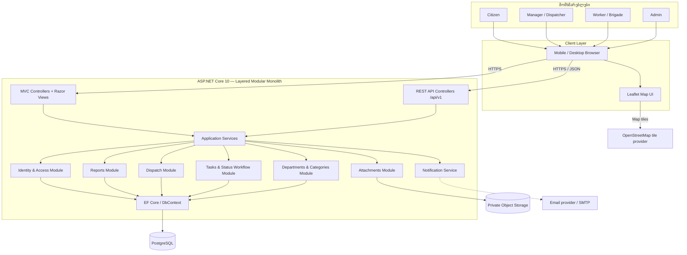
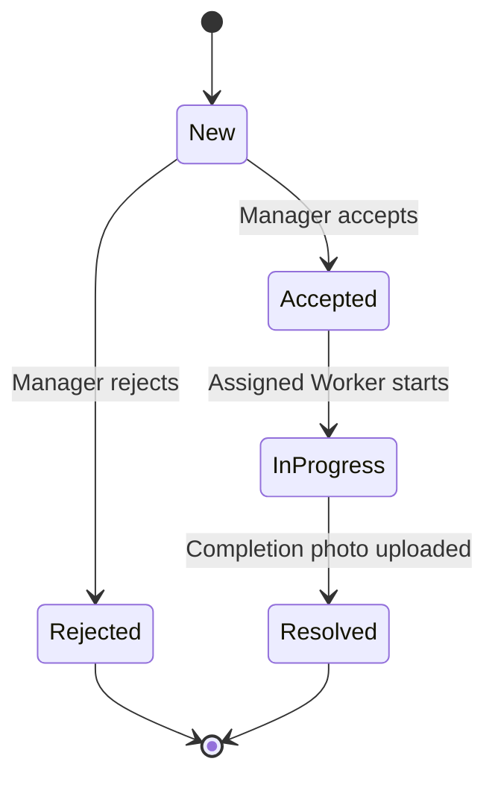
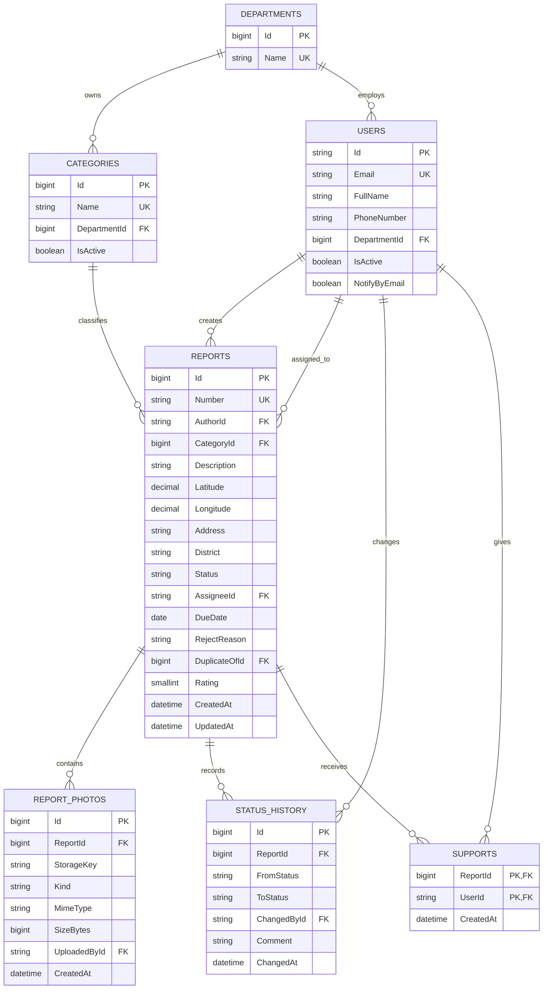

# FixIt — Software Architecture

**პრაქტიკული 2 · სცენარი D: საკუთარი იდეა**  
**არქიტექტურული სტილი:** Layered Modular Monolith  
**Backend:** ASP.NET Core 10 MVC + REST API Controllers  
**Frontend:** Razor Views + Bootstrap 5  
**Database:** PostgreSQL

## 1. არქიტექტურული სტილის არჩევა

FixIt-ისთვის არჩეულია **Layered Modular Monolith** - ერთი deployable ASP.NET Core აპლიკაცია, რომელშიც პასუხისმგებლობები ფენებად და ბიზნესმოდულებად არის დაყოფილი.

ეს სტილი არჩეულია შემდეგი მიზეზებით:

1. **MVP-ის მასშტაბი:** სისტემა თავდაპირველად ერთი მუნიციპალიტეტის სამუშაო პროცესს ემსახურება. ცალკეული microservice-ების განთავსება, ქსელური კომუნიკაცია და დამოუკიდებელი მონაცემთა ბაზები MVP-ისთვის ზედმეტ სირთულეს შექმნიდა.
2. **მონაცემთა თანმიმდევრულობა:** განაცხადის სტატუსის ცვლილება, დავალების მინიჭება და სტატუსის ისტორიის ჩანაწერი ერთ PostgreSQL ტრანზაქციაში შეიძლება შესრულდეს.
3. **შენარჩუნებადობა და გაფართოება:** Identity, Reports, Dispatch, Tasks, Attachments და Notifications ლოგიკურად გამოყოფილი მოდულებია. თუ დატვირთვა ან ორგანიზაციული საჭიროება გაიზრდება, კონკრეტული მოდულის გამოყოფა მომავალში შესაძლებელი იქნება.

**რატომ არა Microservices:** MVP-ის ფუნქციონალი ჯერ მცირე და მჭიდროდ დაკავშირებულია. Microservices მოიტანს დამატებით deployment-ს, service-to-service კომუნიკაციას, distributed tracing-სა და consistency პრობლემებს, რომლებიც ამ ეტაპზე ბიზნესღირებულებას არ მატებს.

## 2. კომპონენტების დიაგრამა

რუკის ფილები მიეწოდება გარე OpenStreetMap ინფრასტრუქტურიდან. FixIt ინახავს კოორდინატებს და არ უნდა იყოს დამოკიდებული იმაზე, რომ მესამე მხარის რუკის ფილები ყოველთვის ხელმისაწვდომია.

## 3. ფენები და მოდულები

| ფენა / მოდული | პასუხისმგებლობა |
|---|---|
| Presentation | MVC Controllers, Razor Views, REST API Controllers, ViewModels და Request/Response DTO-ები. |
| Application | Use case-ები და ბიზნესოპერაციები: CreateReport, AssignReport, UpdateTaskStatus, CompleteTask. |
| Domain | Report, ReportStatus, Category, Department და სტატუსების დაშვებული გადასვლების წესები. |
| Infrastructure | EF Core, PostgreSQL, ASP.NET Identity, File Storage adapter, email adapter და ლოგირება. |

მოდულები:

- **Identity & Access:** რეგისტრაცია, შესვლა, როლები და წვდომის პოლიტიკა.
- **Reports:** განაცხადის შექმნა, დეტალები, საკუთარი განაცხადების სია.
- **Dispatch:** შემოსული განაცხადების ფილტრაცია, მიღება/უარყოფა და თანამშრომელზე მინიჭება.
- **Tasks:** თანამშრომლის დავალებები, `InProgress` სტატუსი და დასრულება.
- **Catalog:** უწყებები და პრობლემის კატეგორიები.
- **Attachments:** ფოტოების ტიპის, ზომისა და ფორმატის შემოწმება; EXIF-ის მოცილება; Object Storage.
- **Notifications:** სტატუსის ცვლილების შემდეგ ელფოსტის გაგზავნა (Should Have ფუნქცია).

## 4. Backend Design Patterns

### 4.1 Service Layer

Controller არ შეიცავს ბიზნესლოგიკას. ის ამოწმებს HTTP მოთხოვნის ფორმას, იძახებს Application Service-ს და აბრუნებს შესაბამის HTTP პასუხს.

მაგალითად, `AssignmentService` ამოწმებს განაცხადის არსებობას, მიმდინარე სტატუსს, მენეჯერის უფლებამოსილებასა და თანამშრომლის აქტიურობას; შემდეგ ტრანზაქციაში ქმნის მინიჭებას და წერს სტატუსის ისტორიას.

### 4.2 Repository + Unit of Work

Repository პასუხისმგებელია მონაცემთა წვდომის კონკრეტულ ოპერაციებზე, ხოლო EF Core `DbContext` უზრუნველყოფს Unit of Work-ს. ერთი `SaveChangesAsync()`-ის ფარგლებში შესაძლებელია განაცხადის და ისტორიის ჩანაწერის ერთობლივი შენახვა.

### 4.3 State Transition Policy

MVP-ში ცალკე კლასების რთული State pattern-ის ნაცვლად გამოიყენება ცენტრალიზებული `ReportStatusRules`, რომელიც განსაზღვრავს დასაშვებ გადასვლებს. ამით Controller-ებში შემთხვევითი `if/else` წესები არ გროვდება.

| მიმდინარე სტატუსი | დაშვებული შემდეგი სტატუსი | ვინ ასრულებს |
|---|---|---|
| `New` | `Accepted`, `Rejected` | Manager |
| `Accepted` | `InProgress` | მინიჭებული Worker |
| `InProgress` | `Resolved` | მინიჭებული Worker — მხოლოდ დასრულების ფოტოს ატვირთვის შემდეგ |
| `Resolved` | გადასვლა აღარ არის MVP-ში | — |
| `Rejected` | გადასვლა აღარ არის MVP-ში | — |

`Resolved → Accepted` გადასვლა MVP-ში არ გამოიყენება. US-16 არის მოქალაქის შეფასება და არა განაცხადის ხელახლა გახსნა.

### 4.4 Dependency Injection

სერვისები და ინფრასტრუქტურული ადაპტერები ინტერფეისებით მიეწოდება. მაგალითად, `IFileStorage`-ს ლოკალური იმპლემენტაცია გამოიყენება development-ში, ხოლო production-ში შეიძლება S3-compatible storage ჩაერთოს.

## 5. Frontend Design Patterns

FixIt-ის MVP იყენებს ASP.NET Core MVC-სა და Razor Views-ს. ცალკე Next.js აპლიკაცია საჭირო არ არის.

### 5.1 ViewModel Pattern

View იღებს სპეციალურად მომზადებულ ViewModel-ს და არა EF Core Entity-ს. მაგალითად, `ReportDetailsViewModel` შეიცავს მხოლოდ იმ ველებს, რომლებიც კონკრეტულ როლს უნდა გამოუჩნდეს. მოქალაქის ტელეფონი და ელფოსტა საჯარო ViewModel-ში არ შედის.

### 5.2 Layout + Partial Views

`_Layout.cshtml` აერთიანებს საერთო Header-ს, Navigation-სა და Footer-ს. `_ReportCard.cshtml` და `_StatusBadge.cshtml` მეორდება მოქალაქის, დისპეჩერისა და თანამშრომლის გვერდებზე.

### 5.3 Progressive Enhancement

ძირითადი ფორმები მუშაობს server-side validation-ით. რუკის ნიშნულის შერჩევა და ფილტრის ინტერაქცია მცირე JavaScript-ით უმჯობესდება; JavaScript-ის შეცდომამ არ უნდა გამოიწვიოს სერვერზე წვდომის კონტროლის გვერდის ავლა.

## 6. REST API — ძირითადი Endpoints

REST API მუშაობს იმავე ASP.NET Core აპლიკაციაში და აბრუნებს JSON-ს. სრული კონტრაქტი მოცემულია [`API_CONTRACT.md`](API_CONTRACT.md)-ში.

| # | Method | Endpoint | როლი | დანიშნულება |
|---:|---|---|---|---|
| 1 | `POST` | `/api/v1/auth/register` | Public | Citizen ანგარიშის შექმნა |
| 2 | `POST` | `/api/v1/auth/login` | Public | ავტორიზაცია |
| 3 | `POST` | `/api/v1/reports` | Citizen | განაცხადის შექმნა (multipart/form-data, 1–3 ფოტო) |
| 4 | `GET` | `/api/v1/reports/mine` | Citizen | საკუთარი განაცხადების სია |
| 5 | `GET` | `/api/v1/manager/reports` | Manager | განაცხადების სია და ფილტრები |
| 6 | `POST` | `/api/v1/manager/reports/{id}/assignment` | Manager | თანამშრომელზე მინიჭება |
| 7 | `GET` | `/api/v1/worker/tasks` | Worker | საკუთარ თავზე მინიჭებული დავალებები |
| 8 | `PATCH` | `/api/v1/worker/tasks/{id}/status` | Worker | დავალების დაწყება (`InProgress`) |
| 9 | `POST` | `/api/v1/worker/tasks/{id}/completion-photo` | Worker | დასრულების ფოტოს ატვირთვა და `Resolved` სტატუსზე გადასვლა |
| 10 | `GET` | `/api/v1/map/reports` | Public | საჯარო რუკის მინიმალური, პირადი მონაცემებისგან დაცლილი მონაცემები (Could/Should scope) |

API მოთხოვნები იყენებს DTO-ებს. Entity Framework Entity პირდაპირ არ ბრუნდება HTTP პასუხში. Role authorization სრულდება სერვერზე, არა მხოლოდ Frontend-ის მენიუში.

## 7. სტატუსის ძირითადი ნაკადი

სტატუსის შეცვლა და `StatusHistory` ჩანაწერის დამატება სრულდება ერთ ტრანზაქციაში. დასრულების ფოტო ინახება და მოწმდება `Resolved`-ზე გადასვლამდე.

## 8. მონაცემთა ბაზა: PostgreSQL

**რატომ SQL და არა NoSQL:** მომხმარებლები, უწყებები, კატეგორიები, განაცხადები, მინიჭებები, ფოტოები და სტატუსების ისტორია დაკავშირებული რელაციური მონაცემებია. Foreign Key-ები და ტრანზაქციები იცავს მონაცემთა მთლიანობას.

MVP-ში გეომონაცემებისთვის საკმარისია `Latitude` და `Longitude` ცალკე სვეტებად. PostGIS არ არის აუცილებელი მხოლოდ რუკაზე წერტილების საჩვენებლად; რთული რადიუსული ან გეოგრაფიული მოთხოვნები შეიძლება მომავალ ვერსიაში დაემატოს.

ფოტოს ბინარული შიგთავსი არ ინახება PostgreSQL-ში. ბაზაში ინახება `StorageKey`, MIME type, ზომა, ფოტო კატეგორია და ატვირთვის მეტამონაცემები; ფაილი ინახება კერძო Object Storage-ში.

### ER Diagram

### ძირითადი შეზღუდვები და ინდექსები

- `Reports.Number` — უნიკალური განაცხადის ნომერი.
- `Categories.Name` და `Departments.Name` — უნიკალური შესაბამისი კონტექსტის ფარგლებში.
- `Reports.Latitude` — `-90 … 90`; `Reports.Longitude` — `-180 … 180`.
- `Reports.Rating` — თუ შევსებულია, უნდა იყოს `1 … 5`.
- `Supports` — კომპოზიტური Primary Key (`ReportId`, `UserId`), რომ მომხმარებელმა ერთ განაცხადს ერთზე მეტჯერ ვერ დაუჭიროს მხარი.
- ინდექსი `Reports(AuthorId, CreatedAt)` მოქალაქის სიისთვის.
- ინდექსი `Reports(Status, CategoryId, CreatedAt)` დისპეჩერის ფილტრებისთვის.
- ინდექსი `Reports(AssigneeId, Status)` თანამშრომლის დავალებებისთვის.
- `StatusHistory(ReportId, ChangedAt)` განაცხადის ისტორიისთვის.

## 9. ტექნოლოგიური სტეკი

| ფენა | ტექნოლოგია | გამოყენება |
|---|---|---|
| Runtime | .NET 10 LTS | მხარდაჭერილი .NET პლატფორმა |
| Web | ASP.NET Core MVC + API Controllers | Razor გვერდები და REST API |
| Frontend | Razor, Bootstrap 5, JavaScript | Responsive UI |
| Map | Leaflet + OpenStreetMap | რუკა და მდებარეობის არჩევა |
| ORM | EF Core 10 + Npgsql | მონაცემთა წვდომა |
| Database | PostgreSQL | რელაციური მონაცემები |
| Auth | ASP.NET Core Identity | პაროლები, ანგარიშები, როლები |
| File processing | ImageSharp ან ეკვივალენტური ბიბლიოთეკა | გამოსახულების ვალიდაცია/EXIF-ის მოცილება/შეკუმშვა |
| Storage | Local dev storage; S3-compatible private object storage production | ფოტოები |
| Testing | xUnit, WebApplicationFactory, k6 | Unit, integration და load tests |
| DevOps | Docker, GitHub Actions | reproducible environment და CI |

## 10. უსაფრთხოება და კონფიდენციალურობა

- პაროლები და ანგარიშები იმართება ASP.NET Core Identity-ით; პაროლი არასოდეს ინახება ღია ტექსტით.
- დაცული ქმედებები მოწმდება `[Authorize]` პოლიტიკით/როლით.
- Cookie-ზე დაფუძნებულ ბრაუზერულ ავტორიზაციასთან ერთად state-changing მოთხოვნებზე გამოიყენება Anti-Forgery დაცვა.
- ფაილების ატვირთვისას მოწმდება ზომა, MIME/type და გაფართოება; ფაილი ინახება კერძო საცავში.
- EXIF მეტამონაცემები იშლება ფოტოს შენახვამდე.
- საჯარო რუკის პასუხში არ ბრუნდება ავტორის სახელი, ელფოსტა, ტელეფონი ან ფაილის კერძო StorageKey.
- ლოგებში არ იწერება პაროლი, Cookie, სრული პირადი კონტაქტი ან ფაილის შიგთავსი.

## 11. რისკები

| რისკი | გავლენა | შემცირების გზა |
|---|---|---|
| Fat Controller-ები | ბიზნესლოგიკის ტესტირება რთულდება | Controller მხოლოდ HTTP orchestration-ს აკეთებს; ლოგიკა Service Layer-შია. |
| ფოტოს პერსონალური მეტამონაცემები | პირადი მდებარეობის/მოწყობილობის მონაცემის გაჟონვა | EXIF-ის მოცილება, კერძო საცავი და ავტორიზებული ფაილის მიწოდება. |
| გარე რუკის სერვისის მიუწვდომლობა | რუკის ფილები არ იტვირთება | კოორდინატები დამოუკიდებლად ინახება; მომხმარებელს აქვს ხელით წერტილის მონიშვნის ალტერნატივა. |
| პარალელური მინიჭება | ერთი განაცხადი ორჯერ შეიძლება მიენიჭოს | concurrency token/row version და ტრანზაქცია; კონფლიქტზე `409`. |
| ზედმეტი მოცულობა | MVP-ის დაგვიანება | MoSCoW და 31-ქულიანი MVP; ახალი იდეები ავტომატურად MVP-ში არ შედის. |

## 12. გაფართოების შესაძლებლობები

მომავალში შეიძლება დაემატოს PostGIS, სტატისტიკური Dashboard, საჯარო რუკა, ელფოსტა/Push შეტყობინებები, გეოგრაფიული დუბლიკატების აღმოჩენა და ცალკეული მოდულების დამოუკიდებელ სერვისებად გამოყოფა. ეს შესაძლებლობები MVP-ის სავალდებულო არქიტექტურულ ნაწილად არ ითვლება.
