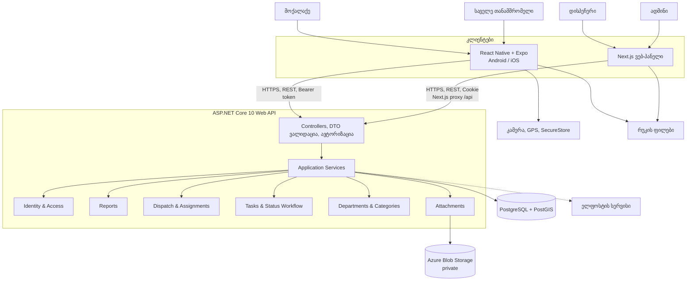
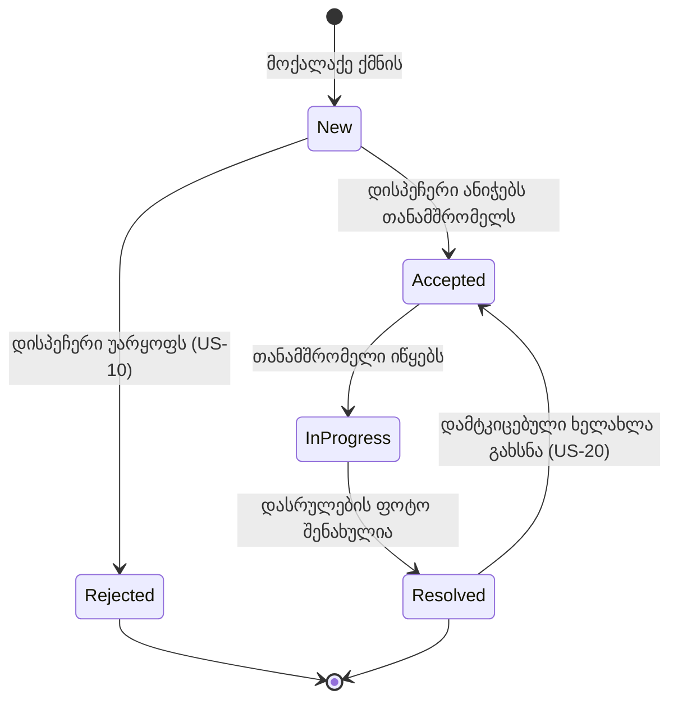
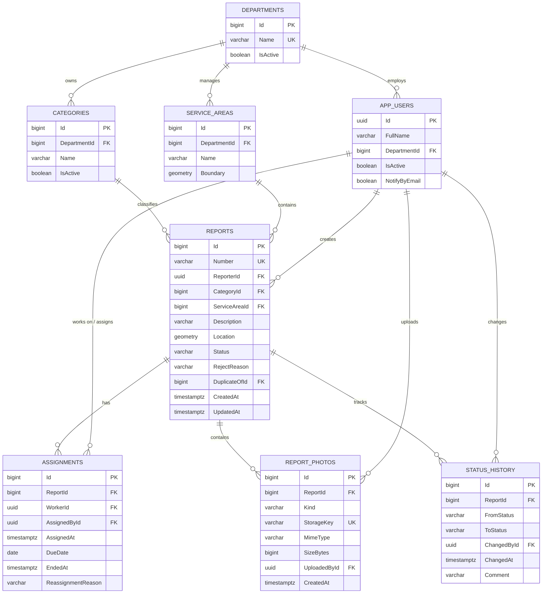

# FixIt: პროგრამული არქიტექტურა

| | |
|---|---|
| სისტემის სტილი | Client-Server |
| Backend-ის სტილი | Layered Modular Monolith |
| მობილური კლიენტი | React Native + Expo + TypeScript (Android/iOS) |
| ვებ-პანელი | Next.js App Router + TypeScript |
| Backend | ASP.NET Core 10 Web API |
| მონაცემთა ბაზა | PostgreSQL + PostGIS |
| ფაილები | Azure Blob Storage, private container |
| ჰოსტინგი | Azure |

## 1. არქიტექტურული გადაწყვეტილება

FixIt-ს აქვს ორი კლიენტი და ერთი Backend. მოქალაქე და საველე თანამშრომელი ტელეფონით მუშაობენ და სჭირდებათ კამერა, GPS და რუკა, ამიტომ მათთვის კეთდება მობილური აპლიკაცია. დისპეჩერსა და ადმინისტრატორს სჭირდებათ დიდი ცხრილები, ფილტრები და მართვის ფორმები, ამიტომ მათთვის კეთდება ვებ-პანელი. Backend არის ერთი ASP.NET Core Web API, რომლის შიგნით კოდი ფენებად და ბიზნესმოდულებად არის დაყოფილი.

**რატომ ეს არქიტექტურა:**

1. **მომხმარებლის საჭიროება.** კამერა, GPS და ტოკენის უსაფრთხო შენახვა მობილური აპლიკაციის ბუნებრივი შესაძლებლობებია, ხოლო დისპეჩერის ცხრილური სამუშაო ვებში უფრო მოსახერხებელია.
2. **ერთი ბიზნესლოგიკა.** ორივე კლიენტი ერთ API-ს იყენებს, ამიტომ განაცხადის, მინიჭებისა და სტატუსის წესები ერთ ადგილას სრულდება, ხოლო PostgreSQL-ის ერთი ტრანზაქცია ინახავს სტატუსს და მის ისტორიას ერთად.
3. **სემესტრის მასშტაბი.** ერთი deploy-ადი Backend და ერთი ბაზა ერთ ადამიანს შეუძლია სამ თვეში ააწყოს და მართოს.

**განხილული ალტერნატივები:**

| ალტერნატივა | რატომ არ აირჩა |
|---|---|
| მხოლოდ responsive ვებსაიტი ან PWA | არ იძლევა ინსტალირებად აპს და კამერის/GPS-ის/SecureStore-ის სრულ ინტეგრაციას; PWA სამომავლო ალტერნატივაა |
| Flutter + ვებ-პანელი | კარგი ვარიანტია, მაგრამ TypeScript ორივე კლიენტში ამცირებს ერთი ადამიანის სამუშაოს |
| მიკროსერვისები | Reports, Assignments და StatusHistory მჭიდროდ არის დაკავშირებული; განაწილებული ტრანზაქციები და ცალკე deploy ზედმეტი სირთულეა |
| MongoDB | მონაცემები რელაციურია და საჭიროებს Foreign Key-ებს და ტრანზაქციებს |
| საკუთარი JWT გამცემი | უსაფრთხოების რისკი; გამოიყენება ASP.NET Core Identity-ის ჩაშენებული ტოკენები |

**შედეგები:** ორი Frontend კოდბაზის მოვლა, Android/iOS ტესტირება და API კონტრაქტის სტაბილურობის საჭიროება. ამას ამცირებს ერთი ენა (TypeScript) კლიენტებში და აქ აღწერილი API კონტრაქტი.

## 2. კომპონენტების დიაგრამა



ელფოსტა MVP-ში გამოიყენება ელფოსტის დადასტურებისა (US-01) და თანამშრომლის მოწვევისთვის (US-13). Push-შეტყობინებები MVP-ში არ შედის.

## 3. ტექნოლოგიები

| ფენა | ტექნოლოგია | რატომ |
|---|---|---|
| მობილური | React Native + Expo + TypeScript | Android და iOS ერთი კოდით; მზა მოდულები კამერისთვის, მდებარეობისთვის და ნავიგაციისთვის |
| მობილური მოდულები | Expo Router, ImagePicker, Location, SecureStore | ნავიგაცია, კამერა/გალერეა, GPS, ტოკენის დაცული შენახვა (არა AsyncStorage) |
| მობილური რუკა | react-native-maps | რუკა და წერტილის მონიშვნა |
| ვები | Next.js App Router + TypeScript, Leaflet | ცხრილები, ფილტრები, მართვის გვერდები, რუკა |
| Backend | ASP.NET Core 10 Web API | DI, ავტორიზაცია, ვალიდაცია, OpenAPI |
| ავთენტიფიკაცია | ASP.NET Core Identity | პაროლის ჰეში (PBKDF2), ბლოკირება, ელფოსტის დადასტურება, Bearer და Cookie სქემები |
| ORM | EF Core 10 + Npgsql + NetTopologySuite | migrations, ტიპიზებული წვდომა, PostGIS ტიპები |
| ბაზა | PostgreSQL + PostGIS | რელაციური მთლიანობა, ტრანზაქციები, მუნიციპალიტეტის საზღვრის შემოწმება |
| ფაილები | Azure Blob Storage (ლოკალურად Azurite) | ფოტოები ბაზისგან ცალკე; მოკლევადიანი SAS ბმულები |
| სურათის დამუშავება | ImageSharp | ფორმატის შემოწმება, EXIF-ის წაშლა, შეკუმშვა |
| ტესტები | xUnit + WebApplicationFactory, React Native Testing Library, Playwright, k6 | Backend, მობილური, ვები, დატვირთვა |
| DevOps | Docker Compose, GitHub Actions, Dependabot | ერთნაირი ლოკალური გარემო, CI, დამოკიდებულებების განახლება |
| მონიტორინგი | Application Insights, uptime მონიტორი | ლოგები, შეცდომები, ხელმისაწვდომობა (NFR-03) |

ვერსიები ფიქსირდება Sprint 0-ში იმ დღის stable გამოშვებებით; Expo-ს native პაკეტები ყენდება `npx expo install`-ით. Secrets (connection string, storage key) არ ინახება Git-ში: ლოკალურად `dotnet user-secrets`, CI-ში GitHub Secrets, Azure-ში App Settings.

## 4. Backend

### 4.1 ფენები

| ფენა | პასუხისმგებლობა | მაგალითები |
|---|---|---|
| Presentation | HTTP, DTO ვალიდაცია, ავტორიზაციის policy-ები, HTTP კოდები | ReportsController, ManagerReportsController, WorkerTasksController |
| Application | use case-ები და ორკესტრაცია | CreateReport, AssignWorker, StartTask, CompleteTask |
| Domain | ბიზნესობიექტები და წესები | Report, Assignment, ReportStatusRules |
| Infrastructure | ტექნიკური ინტეგრაციები | EF Core DbContext, Identity, BlobFileStorage, SmtpEmailSender |

### 4.2 მოდულები

- **Identity & Access:** რეგისტრაცია, შესვლა, ტოკენის განახლება, გასვლა, როლები.
- **Reports:** განაცხადის შექმნა, მოქალაქის სია, დეტალები, ისტორია.
- **Dispatch & Assignments:** დისპეჩერის სია, მინიჭება და გადანაწილება.
- **Tasks & Workflow:** თანამშრომლის დავალებები და სტატუსის გადასვლები.
- **Departments & Categories:** უწყებები, კატეგორიები, მომსახურების არეალები.
- **Attachments:** ფოტოს შემოწმება, EXIF-ის წაშლა, Blob Storage.
- **Notifications:** ელფოსტა (US-05, Should have).

### 4.3 Design Patterns

- **Service Layer / Use Case.** Controller არ შეიცავს ბიზნესლოგიკას: ამოწმებს DTO-ს, იძახებს Application Service-ს და აბრუნებს პასუხს. მაგალითად `AssignWorkerService` ამოწმებს სტატუსს, დისპეჩერის უწყებას და თანამშრომლის აქტიურობას.
- **State Transition Policy.** `ReportStatusRules` ერთ ადგილას ინახავს დაშვებულ გადასვლებს (ნაწილი 6). აკრძალული გადასვლა აბრუნებს 409-ს.
- **Unit of Work.** EF Core-ის ერთი `SaveChangesAsync` ინახავს Report-ის ცვლილებას და StatusHistory-ს ერთად. Generic Repository ყველა ცხრილისთვის არ იქმნება.
- **Dependency Injection და ადაპტერები.** `IFileStorage` (ლოკალურად Azurite, production-ში Blob Storage) და `IEmailSender` (dev-ში sandbox, production-ში SMTP სერვისი) DI-ით მიეწოდება, ამიტომ ტესტებში ადვილად იცვლება.

## 5. Frontend

### 5.1 მობილური: MVVM-ის მსგავსი სტრუქტურა + Repository

ეკრანი (Screen) მხოლოდ UI-ს აჩვენებს. ViewModel-ის როლს ასრულებს feature hook, რომელიც მართავს loading/error/data მდგომარეობას და მომხმარებლის მოქმედებებს. Repository მალავს HTTP-ს დეტალებს, ამიტომ ეკრანი პირდაპირ API-ს არ იძახებს.

```text
mobile/
  app/                    Expo Router-ის ეკრანები
  src/features/
    auth/                 შესვლა, რეგისტრაცია, hook-ები, repository
    reports/              შექმნა, სია, დეტალები
    tasks/                თანამშრომლის დავალებები, დასრულების ფოტო
  src/shared/
    api/                  ტიპიზებული API client
    storage/              SecureStore-ის wrapper
    components/
```

### 5.2 ვები: Feature-based სტრუქტურა

Next.js პანელი იყოფა feature-ებად: `reports`, `assignments`, `users`, `categories`. საერთო API client, auth guard და კომპონენტები `shared`-შია. Server Components იღებს საწყის მონაცემებს, ფილტრები და ფორმები Client Components-შია. Next.js `rewrites` გადაამისამართებს `/api/*` მოთხოვნებს Backend-ზე, ამიტომ ავტორიზაციის Cookie ბრაუზერისთვის იმავე origin-ის Cookie-ა და CORS არ არის საჭირო.

## 6. ავტორიზაცია და უსაფრთხოება

- საჯარო რეგისტრაცია ქმნის მხოლოდ `Citizen` როლს; როლს request-იდან სერვერი არ იღებს.
- მობილური იყენებს ASP.NET Core Identity-ის Bearer token-ს: მოკლევადიანი access token (1 სთ) და refresh token ინახება SecureStore-ში. ეს ტოკენი **JWT არ არის** (Identity-ის საკუთარი დაცული ფორმატია). თუ მომავალში გარე სისტემებს სტანდარტული OAuth2/OIDC დასჭირდება, დაემატება ცალკე Identity Provider.
- ვები იყენებს Secure, HttpOnly, SameSite=Strict Cookie-ს და Anti-Forgery დაცვას ცვლილების მოთხოვნებზე.
- Identity-ს Bearer და Cookie სქემები კონფიგურირდება (`AddIdentityApiEndpoints`), მაგრამ `MapIdentityApi` არ გამოიყენება, რადგან ის საჯარო `/register`-ს როლის გარეშე ხსნის. Endpoint-ები ჩვენს `AuthController`-შია.
- პაროლი ≥ 8 სიმბოლო; 5 წარუმატებელი მცდელობის შემდეგ ანგარიში 15 წუთით იბლოკება (US-01).
- Rate limiting: შესვლა და რეგისტრაცია ≤ 10 მოთხოვნა წუთში IP-ზე; განაცხადის შექმნა ≤ 10 საათში მომხმარებელზე.
- ყოველი დაცული მოთხოვნა ამოწმებს როლსაც და რესურსის მფლობელობას ან უწყებასაც. ღილაკის დამალვა UI-ში უსაფრთხოების კონტროლი არ არის.
- ფოტოს მუდმივი საჯარო ბმული არ არსებობს: API აბრუნებს SAS ბმულს, რომელიც 15 წუთში იწურება.
- ლოგში არ იწერება პაროლი, ტოკენი, ელფოსტა, ტელეფონი და ზუსტი კოორდინატები.

## 7. REST API

### 7.1 წესები

- Base path: `/api/v1`; მხოლოდ HTTPS; JSON, ფოტოსთვის `multipart/form-data`.
- თარიღები ISO 8601 UTC. Pagination: `page` 1-დან, `pageSize` ≤ 100.
- შეცდომები: `application/problem+json`.
- Entity პირდაპირ არ ბრუნდება, მხოლოდ Request/Response DTO. OpenAPI სქემა განახლდება ყოველ ცვლილებაზე.
- ფაილი მოწმდება ზომით, magic bytes-ით და image decoder-ით, არა მხოლოდ გაფართოებით.

### 7.2 MVP endpoint-ები

| Method | Endpoint | წვდომა | დანიშნულება | Story |
|---|---|---|---|---|
| POST | `/auth/register` | საჯარო | მოქალაქის რეგისტრაცია (`fullName`, `email`, `password`, `phoneNumber`) | US-01 |
| POST | `/auth/confirm-email` | საჯარო | ელფოსტის დადასტურება ერთჯერადი კოდით | US-01 |
| POST | `/auth/login` | საჯარო | `useCookies: false` აბრუნებს Bearer ტოკენებს (მობილური), `true` აყენებს Cookie-ს (ვები) | US-01 |
| POST | `/auth/refresh` | მობილური | ახალი access/refresh წყვილი | US-18 |
| POST | `/auth/logout` | ავტორიზებული | სესიის დასრულება | US-18 |
| GET | `/auth/me` | ავტორიზებული | მიმდინარე მომხმარებელი, როლი, უწყება | US-18 |
| GET | `/categories` | ავტორიზებული | აქტიური კატეგორიები ფორმისთვის | US-02 |
| POST | `/reports` | Citizen | განაცხადის შექმნა ფოტოებით და კოორდინატებით | US-02, US-03 |
| GET | `/reports/mine` | Citizen | საკუთარი განაცხადები | US-04 |
| GET | `/reports/{id}` | მფლობელი, უწყების Manager, მინიჭებული Worker | დეტალები და ფოტოების SAS ბმულები | US-04, US-08 |
| GET | `/reports/{id}/history` | იგივე | სტატუსის ისტორია | US-04 |
| GET | `/manager/reports` | Manager | უწყების განაცხადები; ფილტრები `status`, `categoryId`, `serviceAreaId`, `from`, `to` | US-08 |
| GET | `/manager/workers` | Manager | უწყების აქტიური თანამშრომლები მინიჭებისთვის | US-09 |
| POST | `/manager/reports/{id}/assignment` | Manager | მინიჭება ან გადანაწილება | US-09 |
| GET | `/worker/tasks` | Worker | საკუთარი აქტიური დავალებები | US-11 |
| PATCH | `/worker/tasks/{reportId}/status` | მინიჭებული Worker | მხოლოდ `Accepted` → `InProgress` | US-11 |
| POST | `/worker/tasks/{reportId}/completion` | მინიჭებული Worker | დასრულების ფოტო და კომენტარი, სტატუსი `Resolved` | US-12 |
| POST | `/admin/users` | Admin | თანამშრომლის ანგარიში და მოწვევის წერილი | US-13 |
| GET | `/admin/users` | Admin | მომხმარებლების სია | US-13 |
| PATCH | `/admin/users/{id}/role` | Admin | როლი და უწყება | US-13 |
| PATCH | `/admin/users/{id}/status` | Admin | ანგარიშის გათიშვა ან აღდგენა | US-13 |
| GET | `/health` | საჯარო | ხელმისაწვდომობის შემოწმება (ბაზასთან კავშირით) | NFR-03 |

### 7.3 მთავარი მოთხოვნების მაგალითები

**განაცხადის შექმნა** `POST /api/v1/reports` (`multipart/form-data`)

| ველი | ტიპი | წესი |
|---|---|---|
| `categoryId` | integer | არსებული და აქტიური კატეგორია |
| `description` | string | 10-500 სიმბოლო |
| `latitude`, `longitude` | decimal | -90..90, -180..180; წერტილი მუნიციპალიტეტის საზღვარშია |
| `photos` | file[] | 1-3 JPEG/PNG, თითო ≤ 10 MB |

```json
201 Created
{ "id": 1042, "number": "FX-2026-001042", "status": "New", "createdAt": "2026-12-10T10:30:00Z" }
```

**მინიჭება** `POST /api/v1/manager/reports/{id}/assignment`

```json
{ "workerId": "8d0c...", "dueDate": "2026-12-15", "reason": "საწყისი მინიჭება" }

200 OK
{ "reportId": 1042, "status": "Accepted", "activeWorkerId": "8d0c...", "assignedAt": "2026-12-10T11:00:00Z" }
```

**დასრულება** `POST /api/v1/worker/tasks/{reportId}/completion` (`multipart/form-data`: `photo`, ერთი JPEG/PNG ≤ 10 MB; `comment`, არასავალდებულო, ≤ 500 სიმბოლო)

```json
200 OK
{ "reportId": 1042, "status": "Resolved", "completionPhotoId": 987, "resolvedAt": "2026-12-12T15:00:00Z" }
```

### 7.4 HTTP კოდები

| კოდი | როდის |
|---|---|
| 200 / 201 / 204 | წარმატება / შეიქმნა / წარმატება body-ის გარეშე |
| 400 | ვალიდაციის შეცდომა |
| 401 | არ არის ავტორიზებული |
| 403 | როლი ან რესურსზე უფლება არ ჰყოფნის |
| 404 | არ არსებობს, ან მომხმარებელმა მისი არსებობა არ უნდა იცოდეს |
| 409 | დაუშვებელი სტატუსის გადასვლა ან პარალელური ცვლილება |
| 413 / 415 | ფაილი დიდია / ფორმატი დაუშვებელია |
| 429 | rate limit |

### 7.5 MVP-ის შემდეგი endpoint-ები

| Story | Endpoint |
|---|---|
| US-05 ელფოსტით შეტყობინების პარამეტრი | `PATCH /users/me/notification-preferences` |
| US-06 საჯარო რუკა | `GET /map/reports?bbox=...&categoryId=...` (მხოლოდ Accepted, InProgress, Resolved; პერსონალური მონაცემების გარეშე) |
| US-07 მხარდაჭერა | `POST` და `DELETE /reports/{id}/support` |
| US-10 უარყოფა / დუბლიკატი | `PATCH /manager/reports/{id}/rejection` (`reason`, `duplicateOfId`) |
| US-14 კატეგორიები და უწყებები | `/admin/categories`, `/admin/departments` |
| US-15 სტატისტიკა | `GET /admin/analytics/summary`, `GET /admin/analytics/export.csv` |
| US-16 შეფასება | `POST /reports/{id}/rating` |
| US-19 პაროლის აღდგენა | `POST /auth/forgot-password`, `POST /auth/reset-password` |
| US-20 ხელახლა გახსნა | `POST /reports/{id}/reopen-request`, `PATCH /manager/reopen-requests/{id}` |

## 8. სტატუსები და ბიზნესწესები



- **გადანაწილება** შესაძლებელია მხოლოდ `Accepted` სტატუსში: ძველი Assignment იხურება (`EndedAt`), იქმნება ახალი და ინახება მიზეზი. `InProgress` და `Resolved` სტატუსში გადანაწილება აბრუნებს 409-ს.
- **დუბლიკატი** ცალკე სტატუსი არ არის: ეს არის `Rejected` მიზეზით "დუბლიკატი" და `DuplicateOfId`-ით.
- **`Resolved`** მოითხოვს მინიმუმ ერთ `Completion` ფოტოს.
- **ხელახლა გახსნის მოთხოვნა** (US-20) სტატუსს მაშინვე არ ცვლის: იქმნება `Pending` ReopenRequest, და მხოლოდ დისპეჩერის დამტკიცებისას Report ბრუნდება `Accepted`-ში.
- ყოველი სტატუსის ცვლილება და StatusHistory-ს ჩანაწერი ერთ ტრანზაქციაში ინახება.

## 9. მონაცემთა ბაზა

### 9.1 რატომ PostgreSQL + PostGIS

მონაცემები რელაციურია: მომხმარებელი ქმნის Report-ს, Report-ს აქვს Category და ServiceArea, ასევე რამდენიმე Assignment, ფოტო და ისტორიის ჩანაწერი. საჭიროა Foreign Key-ები, შეზღუდვები და ტრანზაქციები. PostGIS გამოიყენება ორ ადგილას: წერტილი მუნიციპალიტეტის საზღვარშია თუ არა (US-03) და რუკის მართკუთხედში მოხვედრილი განაცხადები (US-06).

### 9.2 ცხრილები

Identity იყენებს ASP.NET Core Identity-ის სტანდარტულ ცხრილებს (`AspNetUsers`, `AspNetRoles`, `AspNetUserRoles` ...). `AppUser` ამატებს ველებს `FullName`, `DepartmentId`, `IsActive`, `NotifyByEmail` (US-05).

| ცხრილი | ძირითადი ველები | დანიშნულება |
|---|---|---|
| Departments | Id, Name, IsActive | უწყებები |
| Categories | Id, DepartmentId, Name, IsActive | კატეგორია და პასუხისმგებელი უწყება |
| ServiceAreas | Id, DepartmentId, Name, Boundary | მომსახურების არეალი (უბანი), `geometry(MultiPolygon,4326)` |
| Reports | Id, Number, ReporterId, CategoryId, ServiceAreaId, Description, Location, Status, RejectReason, DuplicateOfId, CreatedAt, UpdatedAt | განაცხადი; `Location` არის `geometry(Point,4326)` |
| Assignments | Id, ReportId, WorkerId, AssignedById, AssignedAt, DueDate, EndedAt, ReassignmentReason | მინიჭებების სრული ისტორია |
| ReportPhotos | Id, ReportId, Kind, StorageKey, MimeType, SizeBytes, UploadedById, CreatedAt | ფოტოს მეტამონაცემები (`Submission` / `Completion`) |
| StatusHistory | Id, ReportId, FromStatus, ToStatus, ChangedById, ChangedAt, Comment | სტატუსის ცვლილებების აუდიტი; დასრულების კომენტარი |
| ReportSupports | ReportId, CitizenId, CreatedAt | US-07, MVP-ის შემდეგ |
| ReportRatings | Id, ReportId, CitizenId, Rating (1-5), CreatedAt | US-16, MVP-ის შემდეგ |
| ReopenRequests | Id, ReportId, RequestedById, Reason, Status, ReviewedById, ReviewedAt, ReviewComment | US-20, MVP-ის შემდეგ |

### 9.3 ER დიაგრამა (MVP)



### 9.4 მონაცემთა წესები

1. `Reports.Number` უნიკალურია (`FX-2026-001042`) და იქმნება sequence-დან.
2. `Categories.DepartmentId` სავალდებულოა: კატეგორია განსაზღვრავს, რომელი უწყების დისპეჩერი ხედავს განაცხადს.
3. `Location`: SRID 4326, X = longitude, Y = latitude. შემოწმება სერვერზე `ST_Covers(boundary, location)`-ით, რომ საზღვარზე მდებარე წერტილიც დაშვებული იყოს.
4. ერთ Report-ს ერთდროულად მაქსიმუმ ერთი აქტიური Assignment აქვს (partial unique index). ორი დისპეჩერის ერთდროული მინიჭება ერთ-ერთს აძლევს 409-ს. Report-ის სტატუსის ცვლილებას იცავს optimistic concurrency (`xmin`).
5. თანამშრომელი და დისპეჩერი ერთ უწყებას უნდა ეკუთვნოდნენ.
6. მომხმარებელი არ იშლება, მხოლოდ ითიშება (`IsActive = false`), რომ ისტორია შენარჩუნდეს; Foreign Key-ები `ON DELETE RESTRICT`.
7. საჯარო რუკის DTO არ შეიცავს ავტორს, კონტაქტს და `StorageKey`-ს.

### 9.5 SQL სქემა (MVP)

Identity-ის ცხრილები იქმნება Identity migration-ით. ქვემოთ მოცემულია ბიზნესცხრილები; საბოლოო სახეს EF Core migration იძლევა.

```sql
CREATE EXTENSION IF NOT EXISTS postgis;

CREATE TABLE departments (
  id bigint GENERATED ALWAYS AS IDENTITY PRIMARY KEY,
  name varchar(120) NOT NULL UNIQUE,
  is_active boolean NOT NULL DEFAULT true
);

CREATE TABLE categories (
  id bigint GENERATED ALWAYS AS IDENTITY PRIMARY KEY,
  department_id bigint NOT NULL REFERENCES departments(id),
  name varchar(120) NOT NULL,
  is_active boolean NOT NULL DEFAULT true,
  UNIQUE (department_id, name)
);

CREATE TABLE service_areas (
  id bigint GENERATED ALWAYS AS IDENTITY PRIMARY KEY,
  department_id bigint NOT NULL REFERENCES departments(id),
  name varchar(120) NOT NULL,
  boundary geometry(MultiPolygon, 4326) NOT NULL
);

CREATE TABLE reports (
  id bigint GENERATED ALWAYS AS IDENTITY PRIMARY KEY,
  number varchar(32) NOT NULL UNIQUE,
  reporter_id uuid NOT NULL REFERENCES "AspNetUsers"("Id"),
  category_id bigint NOT NULL REFERENCES categories(id),
  service_area_id bigint NOT NULL REFERENCES service_areas(id),
  description varchar(500) NOT NULL CHECK (char_length(description) >= 10),
  location geometry(Point, 4326) NOT NULL,
  status varchar(16) NOT NULL DEFAULT 'New'
    CHECK (status IN ('New', 'Accepted', 'InProgress', 'Resolved', 'Rejected')),
  reject_reason varchar(500),
  duplicate_of_id bigint REFERENCES reports(id),
  created_at timestamptz NOT NULL DEFAULT now(),
  updated_at timestamptz NOT NULL DEFAULT now(),
  CHECK (status <> 'Rejected' OR reject_reason IS NOT NULL)
);

CREATE TABLE assignments (
  id bigint GENERATED ALWAYS AS IDENTITY PRIMARY KEY,
  report_id bigint NOT NULL REFERENCES reports(id),
  worker_id uuid NOT NULL REFERENCES "AspNetUsers"("Id"),
  assigned_by_id uuid NOT NULL REFERENCES "AspNetUsers"("Id"),
  assigned_at timestamptz NOT NULL DEFAULT now(),
  due_date date,
  ended_at timestamptz,
  reassignment_reason varchar(500)
);

CREATE TABLE report_photos (
  id bigint GENERATED ALWAYS AS IDENTITY PRIMARY KEY,
  report_id bigint NOT NULL REFERENCES reports(id),
  kind varchar(16) NOT NULL CHECK (kind IN ('Submission', 'Completion')),
  storage_key varchar(500) NOT NULL UNIQUE,
  mime_type varchar(100) NOT NULL,
  size_bytes bigint NOT NULL CHECK (size_bytes > 0 AND size_bytes <= 10485760),
  uploaded_by_id uuid NOT NULL REFERENCES "AspNetUsers"("Id"),
  created_at timestamptz NOT NULL DEFAULT now()
);

CREATE TABLE status_history (
  id bigint GENERATED ALWAYS AS IDENTITY PRIMARY KEY,
  report_id bigint NOT NULL REFERENCES reports(id),
  from_status varchar(16),
  to_status varchar(16) NOT NULL,
  changed_by_id uuid NOT NULL REFERENCES "AspNetUsers"("Id"),
  changed_at timestamptz NOT NULL DEFAULT now(),
  comment varchar(500)
);

CREATE UNIQUE INDEX ux_assignments_one_active ON assignments(report_id) WHERE ended_at IS NULL;
CREATE INDEX ix_assignments_worker_active ON assignments(worker_id, due_date) WHERE ended_at IS NULL;
CREATE INDEX ix_reports_reporter_created ON reports(reporter_id, created_at DESC);
CREATE INDEX ix_reports_status_category_created ON reports(status, category_id, created_at DESC);
CREATE INDEX ix_status_history_report ON status_history(report_id, changed_at);
CREATE INDEX ix_reports_location ON reports USING gist(location);
CREATE INDEX ix_service_areas_boundary ON service_areas USING gist(boundary);
```

### 9.6 ფოტოების შენახვა

1. API ამოწმებს ზომას, magic bytes-ს და ფაილს ხსნის ImageSharp-ით; EXIF იშლება და ფოტო იკუმშება.
2. ფაილი იტვირთება Blob Storage-ის private container-ში შემთხვევითი `StorageKey`-ით.
3. შემდეგ ერთი DB ტრანზაქცია ქმნის Report-ს (ან სტატუსის ცვლილებას), ReportPhotos-ს და StatusHistory-ს.
4. თუ ტრანზაქცია ჩავარდა, ატვირთული ფაილი იშლება; ღამის ფონური ამოცანა (`BackgroundService`) შლის ფაილებს, რომლებსაც ბაზაში ჩანაწერი არ აქვთ.

Blob Storage და PostgreSQL ერთ ACID ტრანზაქციაში ვერ ერთიანდება, ამიტომ თანმიმდევრულობას ეს ოთხი ნაბიჯი უზრუნველყოფს.

## 10. Deployment და DevOps

| გარემო | სად | შემადგენლობა |
|---|---|---|
| ლოკალური | Docker Compose | PostgreSQL + PostGIS, Azurite, API; ვები `npm run dev`; მობილური Expo dev build |
| staging | Azure | იგივე რაც production, მცირე ზომით; ყოველი merge `main`-ში ავტომატურად ეშვება |
| production | Azure | ქვემოთ |

**Production:**

- API: Azure App Service Linux, Basic B1 (SLA 99.95%), Docker image.
- ვებ-პანელი: Azure App Service (Node.js), იმავე დომენზე (`/api` proxy).
- ბაზა: Azure Database for PostgreSQL Flexible Server, PostGIS extension, zonal high availability (SLA 99.95%), ავტომატური ბექაპი 7 დღე, point-in-time restore.
- ფაილები: Azure Blob Storage, private container, SAS ბმულები.
- მობილური: Expo EAS Build; Android APK შიდა გავრცელებით, iOS სიმულატორი დემოსთვის.
- მონიტორინგი: Application Insights და uptime მონიტორი `/health`-ზე ყოველ წუთში.

**ხელმისაწვდომობის გაანგარიშება (NFR-03):** API 99.95% × ბაზა 99.95% ≈ 99.90%, ანუ თვეში დაახლოებით 43 წუთი. ბაზა HA-ს გარეშე იძლევა მხოლოდ 99.9%-ს, რაც ჯამში 99.85%-ს (თვეში ≈ 65 წთ) ნიშნავს, ამიტომ production-ში zonal HA საჭიროა. staging-ს HA არ სჭირდება. Free და Shared App Service გეგმებს SLA არ აქვთ.

**CI/CD (GitHub Actions):**

1. Pull Request: .NET build და ტესტები, ვების lint/typecheck/test, მობილურის lint/typecheck/test, Dependabot და დამოკიდებულებების შემოწმება.
2. Merge `main`-ში: Docker image, EF Core migration staging ბაზაზე, deploy staging-ზე.
3. Production: ხელით დადასტურებით (GitHub Environment approval) Sprint Review-ს შემდეგ.

## 11. არქიტექტურული რისკები

| რისკი | შემცირება |
|---|---|
| Android/iOS-ის განსხვავებები | Expo SDK-ის ფიქსირებული ვერსიები, ტესტი რეალურ Android-ზე და iOS სიმულატორზე |
| GPS-ის უზუსტობა ან ნებართვის უარყოფა | რუკაზე ხელით მონიშვნა, საზღვრის შემოწმება სერვერზე |
| საცავისა და ბაზის შეუთანხმებლობა | ნაწილი 9.6: წაშლა შეცდომისას და ღამის cleanup |
| პერსონალური მონაცემები ფოტოებში | EXIF-ის წაშლა, private container, 15-წუთიანი SAS, ლოგების გაფილტვრა |
| ორი ავთენტიფიკაციის სქემა | endpoint-ების policy-ები სქემების მიხედვით; ვები იმავე origin-ზე proxy-ით |

## 12. გაფართოების გზა

MVP-ის შემდეგ: ელფოსტით და push-შეტყობინებები, საჯარო რუკა, სტატისტიკა, ხელახლა გახსნა, OIDC პროვაიდერი გარე ინტეგრაციებისთვის და, დატვირთვის ზრდისას, ცალკეული მოდულის სერვისად გამოყოფა. ეს MVP-ის ვალდებულება არ არის.
