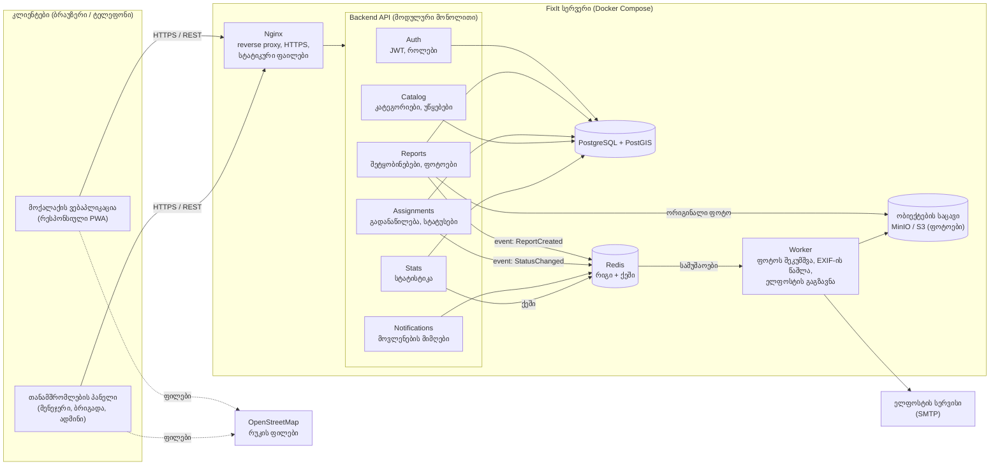
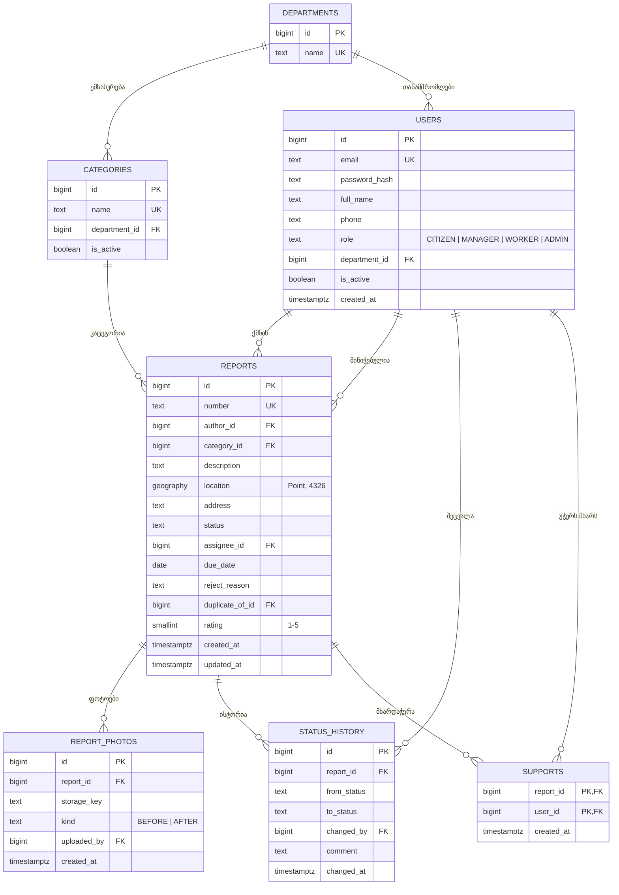

# FixIt: არქიტექტურის არჩევა

**პრაქტიკული 2** · სცენარი **D: საკუთარი იდეა**: FixIt, კომუნალური პრობლემების შეტყობინების სისტემა (იხ. [README.md](README.md) და [BACKLOG.md](BACKLOG.md)).

მოთხოვნები, რომლებიც არქიტექტურას განსაზღვრავს:
- 4 როლი: მოქალაქე, უწყების მენეჯერი, ბრიგადის თანამშრომელი, ადმინი
- ფოტოების ატვირთვა (10 MB-მდე, NFR-3) და რუკა/გეოლოკაცია (US-03, US-06)
- სია და რუკა იტვირთება 2 წამში, 500 ერთდროული მომხმარებელი (NFR-1, NFR-2)
- გუნდი 3-4 სტუდენტი, MVP ერთ სემესტრში (31 ქულა)

## 1. არქიტექტურული სტილი: მოდულური მონოლითი (Modular Monolith)

ერთი გასაშვები backend აპლიკაცია, რომელიც შიგნით დაყოფილია დამოუკიდებელ დომენურ მოდულებად (Auth, Reports, Assignments, Catalog, Notifications, Stats). თითოეულ მოდულს აქვს ფენები: **Controller → Service → Repository**. მძიმე და ნელი სამუშაოები (ფოტოს შეკუმშვა, ელფოსტა) გადადის ცალკე **Worker** პროცესში რიგის (queue) მეშვეობით.

**არგუმენტები:**

1. **გუნდის ზომა და ვადა.** 3-4 სტუდენტი და ერთი სემესტრი. მიკროსერვისები მოითხოვს ცალკე deploy-ს, სერვისებს შორის კომუნიკაციას, განაწილებულ ლოგირებას და ტრანზაქციებს, რაც MVP-ის დროს შეჭამს. მონოლითი იშლება ერთი `docker compose up` ბრძანებით და მარტივად იტესტება.
2. **დატვირთვა ზომიერი და პროგნოზირებადია.** 500 ერთდროული მომხმარებელი და 50 შეტყობინება წუთში (NFR-2) ერთ სერვერზეც კომფორტულად მუშავდება. ონლაინ მაღაზიისგან განსხვავებით, 10-ჯერადი პიკები არ გვაქვს, ამიტომ ცალკეული ნაწილების დამოუკიდებელი სკალირება არ არის საჭირო. საჭიროების შემთხვევაში API ჰორიზონტალურად მრავლდება load balancer-ის უკან, რადგან stateless-ია.
3. **მოდულური საზღვრები მომავლისთვის.** მოდულები ერთმანეთს მიმართავენ მხოლოდ საჯარო ინტერფეისით და დომენური მოვლენებით (events), არა სხვისი ცხრილებით. თუ რომელიმე ნაწილი (მაგ. Notifications ან Stats) მომავალში გაიზრდება, ის ცალკე სერვისად გამოიყოფა მთელი სისტემის გადაწერის გარეშე.

**განხილული და უარყოფილი:** მიკროსერვისები (ზედმეტად რთული ჩვენი მასშტაბისთვის), Serverless (ფოტოების დამუშავებისა და გეო-მოთხოვნების ტესტირება და ლოკალური დეველოპმენტი რთულდება).

## 2. კომპონენტების დიაგრამა



| კომპონენტი | პასუხისმგებლობა | Story-ები |
|------------|------------------|-----------|
| Auth | რეგისტრაცია, შესვლა, JWT, როლებზე დაფუძნებული წვდომა (RBAC) | US-01, US-13 |
| Reports | შეტყობინების შექმნა, ფოტოები, საჯარო რუკა, მხარდაჭერა | US-02, 03, 04, 06, 07 |
| Assignments | მიღება, ბრიგადაზე მინიჭება, სტატუსის ცვლილება, უარყოფა | US-08, 09, 10, 11, 12 |
| Catalog | კატეგორიები და უწყებები | US-14 |
| Notifications | სტატუსის ცვლილებაზე ელფოსტა | US-05 |
| Stats | სტატისტიკა და CSV ექსპორტი | US-15 |
| Worker | ფონური სამუშაოები, რომ API-ის პასუხი არ შენელდეს | NFR-1, NFR-3 |

## 3. Design Pattern-ები

### Backend

| Pattern | სად და რატომ |
|---------|---------------|
| **Repository** | `ReportRepository`, `UserRepository` და ა.შ. ბიზნეს-ლოგიკა (Service) არ იცის SQL-ის შესახებ; ტესტებში Repository იცვლება in-memory ვერსიით. |
| **State** | შეტყობინების სასიცოცხლო ციკლი: `NEW → ACCEPTED → IN_PROGRESS → RESOLVED`, ასევე `NEW/ACCEPTED → REJECTED` და `RESOLVED → ACCEPTED` (ხელახლა გახსნა, US-16). თითოეული მდგომარეობის კლასი თავად წყვეტს, რომელი გადასვლაა დაშვებული, ამიტომ, მაგალითად, `NEW → RESOLVED` შეუძლებელია და `if/else` ჯაჭვები არ გვჭირდება. |
| **Observer (Domain Events)** | `Assignments` მოდული აქვეყნებს მოვლენას `StatusChanged`, `Notifications` კი მას იწერს (subscribe). მოდულები ერთმანეთზე პირდაპირ არ არიან დამოკიდებული, ახალი რეაქციის (მაგ. SMS) დამატება არსებულ კოდს არ ცვლის. |
| **Strategy** | შეტყობინების არხი (`EmailChannel`, მომავალში `SmsChannel`, `PushChannel`) ერთი ინტერფეისით `send(user, message)`. |

### Frontend

| Pattern | სად და რატომ |
|---------|---------------|
| **Container / Presentational** | `ReportListContainer` იღებს მონაცემებს და ფილტრებს, `ReportList` / `ReportCard` მხოლოდ ხატავს. ვიზუალური კომპონენტები ორივე აპლიკაციაში (მოქალაქე, თანამშრომელი) ხელახლა გამოიყენება. |
| **Custom Hook** | `useReports(filters)`, `useGeolocation()`, `useAuth()` მალავს API-ს გამოძახებას, ქეშირებას და შეცდომების დამუშავებას. |
| **Provider (Context)** | `AuthProvider` ინახავს მომხმარებელს და როლს; `ProtectedRoute` ბლოკავს გვერდებს, რომლებზეც როლს წვდომა არ აქვს. |

## 4. API (REST, `/api/v1`)

ავტორიზაცია: `Authorization: Bearer <JWT>`. პასუხები JSON ფორმატშია.

| # | მეთოდი და მისამართი | ვის შეუძლია | აღწერა | Story |
|---|---------------------|-------------|--------|-------|
| 1 | `POST /reports` | მოქალაქე | ახალი შეტყობინება (multipart: ველები + 1-3 ფოტო) | US-02, US-03 |
| 2 | `GET /reports` | ყველა | სია ფილტრებით: `status`, `category`, `bbox` (რუკის საზღვრები), `mine=true`, `page` | US-04, 06, 08 |
| 3 | `GET /reports/{id}` | ყველა* | დეტალები, ფოტოები, სტატუსების ისტორია | US-04, US-08 |
| 4 | `PATCH /reports/{id}/assignment` | მენეჯერი | თანამშრომელზე მინიჭება ვადით | US-09 |
| 5 | `PATCH /reports/{id}/status` | მენეჯერი, თანამშრომელი | სტატუსის ცვლილება (State pattern ამოწმებს დასაშვებობას) | US-10, 11, 12 |

\* მოქალაქის საკონტაქტო მონაცემები პასუხში ბრუნდება მხოლოდ თანამშრომლებისთვის (NFR-5).

**მაგალითი 1: შეტყობინების შექმნა**

```http
POST /api/v1/reports
Content-Type: multipart/form-data

categoryId=3
description=ქუჩის ლამპა არ ანათებს უკვე ერთი კვირაა
lat=41.7151
lng=44.8271
photos=@lamp.jpg
```

```json
201 Created
{
  "id": 1042,
  "number": "FX-2026-001042",
  "status": "NEW",
  "category": { "id": 3, "name": "გარე განათება" },
  "location": { "lat": 41.7151, "lng": 44.8271, "address": "ჭავჭავაძის გამზ. 12" },
  "createdAt": "2026-10-20T09:15:00Z"
}
```

**მაგალითი 2: სტატუსის ცვლილება**

```http
PATCH /api/v1/reports/1042/status
Content-Type: application/json

{ "status": "RESOLVED", "comment": "ნათურა შეიცვალა", "photoIds": [77] }
```

| კოდი | როდის |
|------|-------|
| `200 OK` | გადასვლა დასაშვებია |
| `400 Bad Request` | `RESOLVED` ფოტოს გარეშე (US-12) |
| `403 Forbidden` | თანამშრომელი ცდილობს სხვაზე მინიჭებული ამოცანის შეცვლას |
| `409 Conflict` | დაუშვებელი გადასვლა, მაგ. `NEW → RESOLVED` |

## 5. მონაცემთა ბაზა: SQL (PostgreSQL 16 + PostGIS)

**რატომ SQL და არა NoSQL:**
- მონაცემები მკაფიოდ რელაციურია: მომხმარებელი → შეტყობინება → მინიჭება → სტატუსების ისტორია → უწყება.
- სტატუსის ცვლილება და ისტორიის ჩანაწერი ერთ **ტრანზაქციაში** უნდა მოხდეს (ACID).
- **PostGIS** იძლევა გეო-მოთხოვნებს: „ყველა შეტყობინება რუკის ხილულ არეში" ან „მსგავსი პრობლემები 50 მეტრის რადიუსში" (დუბლიკატების აღმოჩენა, US-07, US-10) GiST ინდექსით, მილიწამებში.
- სტატისტიკა (US-15) არის `GROUP BY` და აგრეგაციები, რაც SQL-ის ძლიერი მხარეა.

ფოტოები ბაზაში არ ინახება: ბაზაში არის მხოლოდ ბმული (`storage_key`), თავად ფაილი კი ობიექტების საცავშია.

### ER დიაგრამა



### ძირითადი ცხრილი (SQL)

```sql
CREATE TYPE report_status AS ENUM
  ('NEW', 'ACCEPTED', 'IN_PROGRESS', 'RESOLVED', 'REJECTED');

CREATE TABLE reports (
  id              BIGSERIAL PRIMARY KEY,
  number          TEXT UNIQUE NOT NULL,
  author_id       BIGINT NOT NULL REFERENCES users(id),
  category_id     BIGINT NOT NULL REFERENCES categories(id),
  description     TEXT NOT NULL CHECK (char_length(description) BETWEEN 10 AND 500),
  location        GEOGRAPHY(Point, 4326) NOT NULL,
  address         TEXT,
  status          report_status NOT NULL DEFAULT 'NEW',
  assignee_id     BIGINT REFERENCES users(id),
  due_date        DATE,
  reject_reason   TEXT,
  duplicate_of_id BIGINT REFERENCES reports(id),
  rating          SMALLINT CHECK (rating BETWEEN 1 AND 5),
  created_at      TIMESTAMPTZ NOT NULL DEFAULT now(),
  updated_at      TIMESTAMPTZ NOT NULL DEFAULT now()
);

CREATE INDEX reports_location_gix   ON reports USING GIST (location);
CREATE INDEX reports_status_cat_idx ON reports (status, category_id, created_at DESC);
CREATE INDEX reports_assignee_idx   ON reports (assignee_id) WHERE status IN ('ACCEPTED', 'IN_PROGRESS');
```

## 6. ტექნოლოგიური სტეკი

| ფენა | ტექნოლოგია | რატომ |
|------|------------|-------|
| Frontend | **React + TypeScript + Vite**, React Router, TanStack Query | ფართოდ გავრცელებული, გუნდისთვის ნაცნობი; TanStack Query ქეშირებს სიებს (NFR-1) |
| რუკა | **Leaflet + OpenStreetMap** | უფასოა, API გასაღებს არ საჭიროებს |
| UI | Tailwind CSS, PWA (Service Worker) | რესპონსიული 360 px-დან (NFR-6), ტელეფონის მთავარ ეკრანზე დამატება ნატიური აპის გარეშე |
| Backend | **Node.js + NestJS (TypeScript)** | NestJS-ის `Module` სისტემა პირდაპირ ერგება მოდულურ მონოლითს; ერთი ენა frontend-სა და backend-ში |
| ORM | Prisma | ტიპიზებული მოთხოვნები, მიგრაციები |
| ბაზა | **PostgreSQL 16 + PostGIS** | იხ. ნაწილი 5 |
| რიგი / ქეში | Redis + BullMQ | ფონური სამუშაოები Worker-ისთვის |
| ფაილები | MinIO (ლოკალურად), S3-თავსებადი საცავი (production) | ფოტოები ბაზის გარეთ |
| ტესტები | Jest, Supertest, Playwright, k6 (დატვირთვის ტესტი NFR-2-ისთვის) | DoD: დაფარვა ≥ 70% |
| DevOps | Docker, Docker Compose, **GitHub Actions** (build, lint, test, deploy), Nginx | ერთი ბრძანებით გაშვება, CI ყოველ PR-ზე |

## 7. რისკები და მათი შემცირება

| # | რისკი | ალბათობა / გავლენა | შემცირება |
|---|-------|--------------------|-----------|
| 1 | **პერსონალური მონაცემები ფოტოებში.** ფოტოს EXIF-ში შეიძლება იყოს ზუსტი GPS და მოწყობილობის მონაცემები, კადრში კი ადამიანების სახეები და ავტომობილის ნომრები. ეს იურიდიული სამსახურის ვეტოს რისკია. | საშუალო / მაღალი | Worker შლის EXIF-ს ყველა ფოტოდან; საჯარო რუკაზე ფოტო ჩანს მხოლოდ მოდერაციის შემდეგ; შენახვის ვადა 3 წელი (NFR-3); წვდომა ფოტოებზე დროებითი ხელმოწერილი ბმულებით. |
| 2 | **ყალბი შეტყობინებები და დუბლიკატები.** ერთ ორმოზე 30 შეტყობინება ან სპამი გადატვირთავს მენეჯერს. | მაღალი / საშუალო | ავტორიზაცია სავალდებულოა (ანონიმური = Won't have); rate limit 10 შეტყობინება დღეში მომხმარებელზე; ფორმაში PostGIS-ით ჩანს „ახლოს უკვე არის მსგავსი" და შეთავაზება „მეც ვადასტურებ" (US-07). |
| 3 | **მონოლითის „გახლართვა" და ერთი წერტილის ჩავარდნა.** დროთა განმავლობაში მოდულები შეიძლება ერთმანეთის ცხრილებს პირდაპირ მიმართავდნენ, ხოლო ერთი სერვერის გათიშვა მთელ სისტემას აჩერებს (NFR-4: 99.5%). | საშუალო / საშუალო | მოდულებს შორის მხოლოდ საჯარო სერვისები და მოვლენები, რასაც ESLint-ის წესი (`no-restricted-imports`) და code review ამოწმებს; ბაზის ყოველდღიური ბექაპი; health-check და ავტომატური გადატვირთვა (`restart: always`); stateless API, რომ საჭიროებისას მეორე ინსტანსი დაემატოს. |

## 8. პრეზენტაციის გეგმა (15 წთ)

| დრო | თემა |
|-----|------|
| 2 წთ | პროდუქტი და მოთხოვნები (როლები, NFR) |
| 3 წთ | სტილი: მოდულური მონოლითი + 3 არგუმენტი, რატომ არა მიკროსერვისები |
| 3 წთ | კომპონენტების დიაგრამა და შეტყობინების გზა: ფორმა → API → ბაზა → რიგი → Worker → ელფოსტა |
| 2 წთ | Pattern-ები: State (სტატუსები) და Observer (შეტყობინებები) |
| 2 წთ | API და ბაზის სქემა, რატომ PostgreSQL + PostGIS |
| 3 წთ | სტეკი, რისკები და კითხვები |
