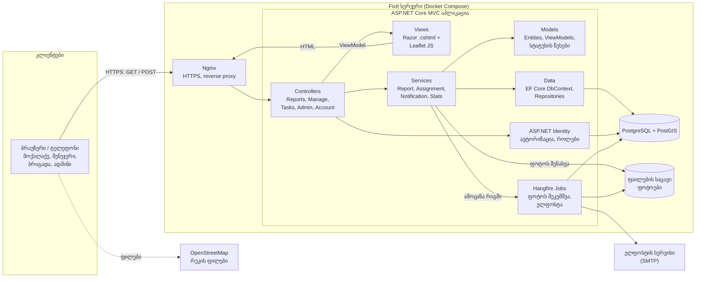
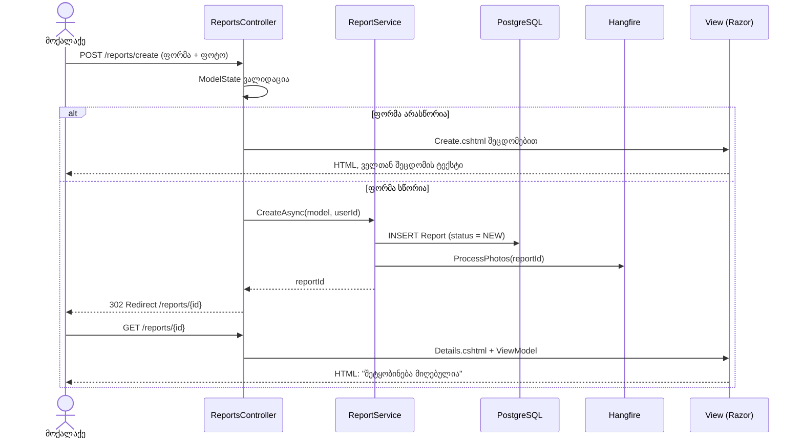
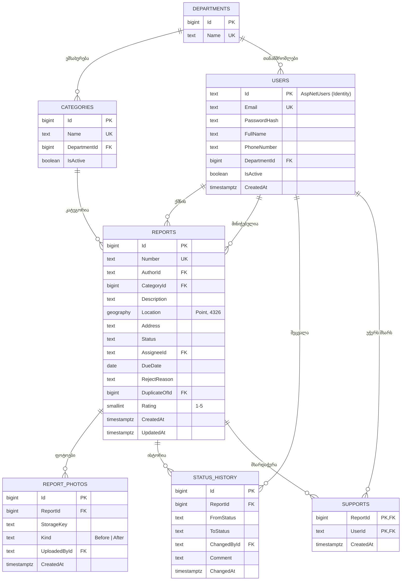

# FixIt: არქიტექტურის არჩევა

**პრაქტიკული 2** · სცენარი **D: საკუთარი იდეა**: FixIt, კომუნალური პრობლემების შეტყობინების სისტემა (იხ. [README.md](README.md) და [BACKLOG.md](BACKLOG.md)).
**პრეზენტაცია:** [docs/FixIt-Architecture.pptx](docs/FixIt-Architecture.pptx)

მოთხოვნები, რომლებიც არქიტექტურას განსაზღვრავს:
- 4 როლი: მოქალაქე, უწყების მენეჯერი, ბრიგადის თანამშრომელი, ადმინი
- ფოტოების ატვირთვა (10 MB-მდე, NFR-3) და რუკა/გეოლოკაცია (US-03, US-06)
- სია და რუკა იტვირთება 2 წამში, 500 ერთდროული მომხმარებელი (NFR-1, NFR-2)
- გუნდი 3-4 სტუდენტი, MVP ერთ სემესტრში (31 ქულა)

## 1. არქიტექტურული სტილი: MVC + ფენოვანი (Layered) მონოლითი

FixIt არის ერთი **ASP.NET Core MVC** აპლიკაცია, სადაც სერვერი თავად აგენერირებს HTML გვერდებს (server-side rendering). კოდი დაყოფილია სამ MVC როლად და მათ უკან ორ დამატებით ფენად:

| ფენა | რას აკეთებს | FixIt-ში |
|------|-------------|----------|
| **Model** | მონაცემები და ბიზნეს-წესები | `Report`, `User`, `Category`, სტატუსების წესები (State pattern), ViewModel-ები |
| **View** | რას ხედავს მომხმარებელი | Razor გვერდები (`.cshtml`): ფორმა, სია, რუკა, მენეჯერის პანელი |
| **Controller** | იღებს მოთხოვნას, იძახებს სერვისს, ირჩევს View-ს | `ReportsController`, `ManageController`, `TasksController`, `AdminController` |
| Service | ბიზნეს-ლოგიკა, რომ Controller-ები „მსუქანი" არ გახდეს | `ReportService`, `AssignmentService`, `NotificationService` |
| Repository / Data | ბაზასთან მუშაობა | Entity Framework Core, `FixItDbContext` |

მძიმე და ნელი სამუშაოები (ფოტოს შეკუმშვა, ელფოსტა) გადადის ფონურ ამოცანებში (**Hangfire**), რომ მომხმარებელს პასუხის ლოდინი არ მოუწიოს.

**არგუმენტები:**

1. **სწრაფი დეველოპმენტი მცირე გუნდისთვის.** MVC-ში ერთ პროექტში ერთად არის UI და backend: არ გვჭირდება ცალკე SPA (React), ცალკე API-ის ვერსიონირება და ორი deploy. ASP.NET Core MVC-ს მზად აქვს ავტორიზაცია და როლები (Identity), ფორმების ვალიდაცია, CSRF დაცვა და EF Core მიგრაციები. 3-4 სტუდენტისთვის ეს ნიშნავს, რომ დრო MVP-ის 9 story-ზე იხარჯება და არა ინფრასტრუქტურაზე.
2. **ჩვენი ინტერფეისი ძირითადად ფორმები და სიებია.** შეტყობინების ფორმა, მენეჯერის სია ფილტრებით, ამოცანების სია, ადმინის ცხრილები. ეს კლასიკური CRUD სცენარებია, რომლებიც სერვერზე დახატულ გვერდებს იდეალურად ერგება. ინტერაქტიული ნაწილი მხოლოდ რუკაა, რომელსაც Leaflet-ის მცირე JavaScript ფაილი ემსახურება. სერვერზე დახატული გვერდი ტელეფონზეც სწრაფად იხსნება (NFR-1: 2 წამი), რადგან დიდი JS bundle-ის ჩამოტვირთვა არ სჭირდება.
3. **პასუხისმგებლობების მკაფიო გამიჯვნა.** Model, View და Controller ცალ-ცალკეა, ბიზნეს-ლოგიკა კი Service ფენაშია. ამიტომ გუნდის წევრებს შეუძლიათ პარალელურად იმუშაონ (ერთი View-ებზე, მეორე სერვისებზე), ხოლო სერვისები Controller-ის გარეშე იტესტება unit ტესტებით (DoD: დაფარვა ≥ 70%). თუ მომავალში მობილური აპლიკაცია (US-18) დაგვჭირდება, იმავე სერვისებზე დაემატება `ApiController`-ები.

**განხილული და უარყოფილი:** მიკროსერვისები (ზედმეტად რთული ჩვენი მასშტაბისთვის); SPA (React) + ცალკე REST API (ორი პროექტი, ორი deploy და ორმაგი ვალიდაცია MVP-სთვის გაუმართლებელია).

## 2. კომპონენტების დიაგრამა



### MVC მოთხოვნის გზა: მოქალაქე აგზავნის შეტყობინებას



| კომპონენტი | პასუხისმგებლობა | Story-ები |
|------------|------------------|-----------|
| `AccountController` + Identity | რეგისტრაცია, შესვლა, ანგარიშის დაბლოკვა 5 მცდელობის შემდეგ | US-01 |
| `ReportsController` | შეტყობინების შექმნა, ჩემი შეტყობინებები, საჯარო რუკა, მხარდაჭერა | US-02, 03, 04, 06, 07 |
| `ManageController` | მენეჯერის სია ფილტრებით, მინიჭება, უარყოფა | US-08, 09, 10 |
| `TasksController` | ბრიგადის ამოცანები, სტატუსის განახლება, დასრულება ფოტოთი | US-11, US-12 |
| `AdminController` | მომხმარებლები, როლები, კატეგორიები, უწყებები | US-13, US-14 |
| `StatsController` | სტატისტიკა და CSV ექსპორტი | US-15 |
| Hangfire Jobs | ფოტოს შეკუმშვა და EXIF-ის წაშლა, ელფოსტა | US-05, NFR-3 |

## 3. Design Pattern-ები

### Backend

| Pattern | სად და რატომ |
|---------|---------------|
| **MVC** | საბაზისო pattern: Controller იღებს მოთხოვნას, Model ინახავს მონაცემებს და წესებს, View ხატავს HTML-ს. |
| **Repository + Unit of Work** | `IReportRepository` მალავს EF Core-ის მოთხოვნებს; `DbContext.SaveChangesAsync()` არის Unit of Work: სტატუსის ცვლილება და ისტორიის ჩანაწერი ერთ ტრანზაქციაში ინახება. ტესტებში Repository იცვლება mock-ით. |
| **Dependency Injection** | ASP.NET Core-ის ჩაშენებული DI: Controller იღებს `IReportService`-ს კონსტრუქტორში და არ იცის, რომელი კლასი დგას უკან. |
| **State** | შეტყობინების სასიცოცხლო ციკლი: `New → Accepted → InProgress → Resolved`, ასევე `New/Accepted → Rejected` და `Resolved → Accepted` (ხელახლა გახსნა, US-16). თითოეული მდგომარეობის კლასი თავად წყვეტს, რომელი გადასვლაა დაშვებული, ამიტომ `New → Resolved` შეუძლებელია და `if/else` ჯაჭვები არ გვჭირდება. |
| **Observer (Domain Events)** | `AssignmentService` აქვეყნებს მოვლენას `ReportStatusChanged` (MediatR notification), `EmailNotificationHandler` კი მას იჭერს და Hangfire-ში ამატებს ელფოსტის გაგზავნას. ახალი რეაქციის (მაგ. SMS) დამატება არსებულ კოდს არ ცვლის. |
| **Strategy** | `IFileStorage`: `LocalFileStorage` დეველოპმენტისთვის და `S3FileStorage` production-ისთვის; კონკრეტული კლასი `appsettings.json`-ით ირჩევა. |

### Frontend (Razor View-ები)

| Pattern | სად და რატომ |
|---------|---------------|
| **ViewModel** | View არასოდეს იღებს ბაზის Entity-ს პირდაპირ: `ReportCreateViewModel` შეიცავს მხოლოდ ფორმის ველებს და ვალიდაციის ატრიბუტებს (`[Required]`, `[StringLength(500, MinimumLength = 10)]`), `ReportDetailsViewModel` კი მოქალაქის კონტაქტს მხოლოდ თანამშრომლისთვის შეიცავს (NFR-5). |
| **Layout + Partial View** | `_Layout.cshtml` ერთი ნავიგაციით ყველა გვერდისთვის; `_ReportCard.cshtml` და `_StatusBadge.cshtml` ერთხელ იწერება და მოქალაქის, მენეჯერის და ბრიგადის გვერდებზე მეორდება. |
| **View Component** | `MyTasksCountViewComponent` აჩვენებს ბრიგადის აქტიური ამოცანების რაოდენობას მენიუში; საკუთარი ლოგიკა აქვს და Controller-ზე არ არის დამოკიდებული. |
| **Tag Helper** | `<form asp-action="Create">`, `<span asp-validation-for="Description">` ავტომატურად ამატებს მარშრუტს, CSRF ტოკენს და კლიენტის მხარის ვალიდაციას. |

## 4. Endpoint-ები (MVC მარშრუტები)

MVC-ში endpoint არის **Controller-ის action**, რომელიც აბრუნებს HTML-ს (View) ან გადამისამართებას (Redirect). წვდომა კონტროლდება ატრიბუტით `[Authorize(Roles = "...")]`, ფორმები დაცულია `[ValidateAntiForgeryToken]`-ით.

| # | მეთოდი და მარშრუტი | Controller.Action | ვის შეუძლია | აბრუნებს | Story |
|---|---------------------|-------------------|-------------|----------|-------|
| 1 | `POST /reports/create` | `ReportsController.Create` | მოქალაქე | Redirect დეტალებზე ან View შეცდომებით | US-02, US-03 |
| 2 | `GET /reports?status=&category=&mine=true&page=` | `ReportsController.Index` | ავტორიზებული | View: სია ფილტრებით | US-04, US-08 |
| 3 | `GET /reports/{id}` | `ReportsController.Details` | ავტორიზებული | View: დეტალები, ფოტოები, ისტორია | US-04, US-08 |
| 4 | `POST /manage/reports/{id}/assign` | `ManageController.Assign` | მენეჯერი | Redirect სიაზე + შეტყობინება | US-09 |
| 5 | `POST /tasks/{id}/status` | `TasksController.UpdateStatus` | მენეჯერი, ბრიგადა | Redirect ან 400/403/409 | US-10, 11, 12 |

დამატებით, რუკისთვის ერთი JSON endpoint (Leaflet-ი ნიშნულებს გვერდის გადატვირთვის გარეშე ტვირთავს):

| მეთოდი და მარშრუტი | Controller.Action | აბრუნებს | Story |
|---------------------|-------------------|----------|-------|
| `GET /api/map/reports?bbox=44.7,41.6,44.9,41.8&category=3` | `MapApiController.Get` | JSON: `[{ id, lat, lng, status, category }]`, ავტორის მონაცემების გარეშე | US-06 |

**მაგალითი: Controller-ის action**

```csharp
[Authorize(Roles = "Citizen")]
[HttpPost("reports/create"), ValidateAntiForgeryToken]
public async Task<IActionResult> Create(ReportCreateViewModel model)
{
    if (!ModelState.IsValid)
        return View(model);                       // ფორმა შეცდომებით (US-02, სცენარი 2)

    var id = await _reportService.CreateAsync(model, User.GetUserId());
    TempData["Success"] = "შეტყობინება მიღებულია";
    return RedirectToAction(nameof(Details), new { id });
}
```

**სტატუსის ცვლილების პასუხები (`POST /tasks/{id}/status`):**

| კოდი | როდის |
|------|-------|
| `302 Redirect` | გადასვლა დასაშვებია, მომხმარებელი ბრუნდება ამოცანების სიაზე |
| `400 Bad Request` | `Resolved` ფოტოს გარეშე (US-12): View ბრუნდება შეცდომით |
| `403 Forbidden` | თანამშრომელი ცდილობს სხვაზე მინიჭებული ამოცანის შეცვლას |
| `409 Conflict` | დაუშვებელი გადასვლა, მაგ. `New → Resolved` |

## 5. მონაცემთა ბაზა: SQL (PostgreSQL 16 + PostGIS)

**რატომ SQL და არა NoSQL:**
- მონაცემები მკაფიოდ რელაციურია: მომხმარებელი → შეტყობინება → მინიჭება → სტატუსების ისტორია → უწყება.
- სტატუსის ცვლილება და ისტორიის ჩანაწერი ერთ **ტრანზაქციაში** უნდა მოხდეს (ACID).
- **EF Core** და **ASP.NET Identity** რელაციურ ბაზაზეა აგებული: მიგრაციები, კავშირები და Identity-ს ცხრილები მზად მოდის.
- **PostGIS** (EF Core-ში NetTopologySuite-ით) იძლევა გეო-მოთხოვნებს: „ყველა შეტყობინება რუკის ხილულ არეში" ან „მსგავსი პრობლემები 50 მეტრის რადიუსში" (დუბლიკატების აღმოჩენა, US-07, US-10).
- სტატისტიკა (US-15) არის `GROUP BY` და აგრეგაციები, რაც SQL-ის ძლიერი მხარეა.

ფოტოები ბაზაში არ ინახება: ბაზაში არის მხოლოდ ბმული (`StorageKey`), თავად ფაილი კი ფაილების საცავშია.

### ER დიაგრამა



როლები (`Citizen`, `Manager`, `Worker`, `Admin`) ინახება Identity-ს სტანდარტულ ცხრილებში `AspNetRoles` და `AspNetUserRoles`.

### Model (EF Core Entity)

```csharp
public enum ReportStatus { New, Accepted, InProgress, Resolved, Rejected }

public class Report
{
    public long Id { get; set; }
    public string Number { get; set; } = default!;          // FX-2026-001042
    public string AuthorId { get; set; } = default!;
    public ApplicationUser Author { get; set; } = default!;
    public long CategoryId { get; set; }
    public Category Category { get; set; } = default!;

    [StringLength(500, MinimumLength = 10)]
    public string Description { get; set; } = default!;
    public Point Location { get; set; } = default!;        // PostGIS, SRID 4326
    public string? Address { get; set; }

    public ReportStatus Status { get; set; } = ReportStatus.New;
    public string? AssigneeId { get; set; }
    public ApplicationUser? Assignee { get; set; }
    public DateOnly? DueDate { get; set; }
    public string? RejectReason { get; set; }
    public long? DuplicateOfId { get; set; }
    public short? Rating { get; set; }

    public List<ReportPhoto> Photos { get; set; } = new();
    public List<StatusHistory> History { get; set; } = new();
    public DateTime CreatedAt { get; set; } = DateTime.UtcNow;
}
```

ინდექსები (`FixItDbContext.OnModelCreating`): GiST ინდექსი `Location`-ზე, კომპოზიტური ინდექსი `(Status, CategoryId, CreatedAt)` მენეჯერის სიისთვის და ინდექსი `AssigneeId`-ზე ბრიგადის ამოცანებისთვის.

## 6. ტექნოლოგიური სტეკი

| ფენა | ტექნოლოგია | რატომ |
|------|------------|-------|
| ფრეიმვორკი | **ASP.NET Core 8 MVC (C#)** | MVC, DI, ვალიდაცია, CSRF დაცვა ჩაშენებულია; LTS ვერსია |
| View | **Razor** (`.cshtml`), Bootstrap 5, Tag Helpers | რესპონსიული 360 px-დან (NFR-6), ფორმები და ვალიდაცია მინიმალური JS-ით |
| რუკა | **Leaflet + OpenStreetMap** | უფასოა, API გასაღებს არ საჭიროებს |
| ავტორიზაცია | **ASP.NET Core Identity** | რეგისტრაცია, როლები, ანგარიშის დაბლოკვა, პაროლის ჰეშირება (NFR-5) |
| ORM | **Entity Framework Core 8** + Npgsql + NetTopologySuite | მიგრაციები, LINQ მოთხოვნები, PostGIS მხარდაჭერა |
| ბაზა | **PostgreSQL 16 + PostGIS** | იხ. ნაწილი 5 |
| ფონური ამოცანები | **Hangfire** (PostgreSQL storage) | ცალკე Redis არ სჭირდება; აქვს dashboard ამოცანების სანახავად |
| ფოტოები | ImageSharp (შეკუმშვა, EXIF-ის წაშლა), ლოკალური დისკი / S3-თავსებადი საცავი | NFR-3: ≤ 1 MB |
| ელფოსტა | MailKit + SMTP | US-05 |
| Event-ები | MediatR | Observer pattern, ReportStatusChanged |
| ტესტები | **xUnit**, Moq, `WebApplicationFactory` (ინტეგრაციული), Playwright, k6 (დატვირთვა, NFR-2) | DoD: დაფარვა ≥ 70% |
| DevOps | Docker, Docker Compose, **GitHub Actions** (build, test, deploy), Nginx | ერთი ბრძანებით გაშვება, CI ყოველ PR-ზე |

## 7. რისკები და მათი შემცირება

| # | რისკი | ალბათობა / გავლენა | შემცირება |
|---|-------|--------------------|-----------|
| 1 | **„მსუქანი" Controller-ები (Fat Controller).** MVC-ში ხშირი შეცდომაა, როცა ბიზნეს-ლოგიკა, ვალიდაცია და ბაზასთან მუშაობა პირდაპირ Controller-ში იწერება. კოდი ძნელად იტესტება და ერთი ცვლილება ბევრ ადგილს ეხება. | მაღალი / საშუალო | ყველა ლოგიკა Service ფენაშია, Controller-ის action არ აღემატება ~15 ხაზს; სტატუსის წესები State pattern-შია; code review-ში ეს DoD-ის ნაწილია. |
| 2 | **პერსონალური მონაცემები ფოტოებში.** ფოტოს EXIF-ში შეიძლება იყოს ზუსტი GPS და მოწყობილობის მონაცემები, კადრში კი ადამიანების სახეები და ავტომობილის ნომრები. ეს იურიდიული სამსახურის ვეტოს რისკია. | საშუალო / მაღალი | Hangfire job შლის EXIF-ს ყველა ფოტოდან; საჯარო რუკაზე ფოტო ჩანს მხოლოდ მოდერაციის შემდეგ; ViewModel-ები კონტაქტს მხოლოდ თანამშრომლებს აჩვენებს; შენახვის ვადა 3 წელი (NFR-3). |
| 3 | **სერვერზე დახატული გვერდების სისწრაფე და ერთი სერვერის ჩავარდნა.** ყოველი ფილტრის ცვლილება გვერდს თავიდან ტვირთავს, ერთი სერვერის გათიშვა კი მთელ სისტემას აჩერებს (NFR-1: 2 წამი, NFR-4: 99.5%). | საშუალო / საშუალო | Output Caching საჯარო რუკაზე, გვერდებად დაყოფა (20 ჩანაწერი), Response Compression, ბაზის ინდექსები; health-check და `restart: always`; ბაზის ყოველდღიური ბექაპი; აპლიკაცია stateless-ია (სესია cookie-ში), ამიტომ საჭიროებისას Nginx-ის უკან მეორე ინსტანსი ემატება. k6 ტესტით ვამოწმებთ 500 მომხმარებელს. |

## 8. პრეზენტაცია

სლაიდები: [docs/FixIt-Architecture.pptx](docs/FixIt-Architecture.pptx) (12 სლაიდი, ~13 წუთი; სპიკერის ტექსტი თითოეული სლაიდის შენიშვნებშია).
