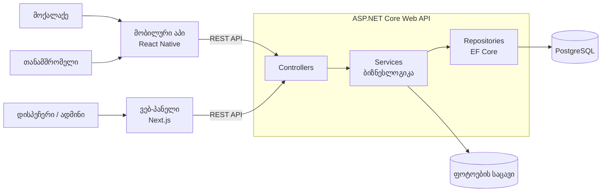
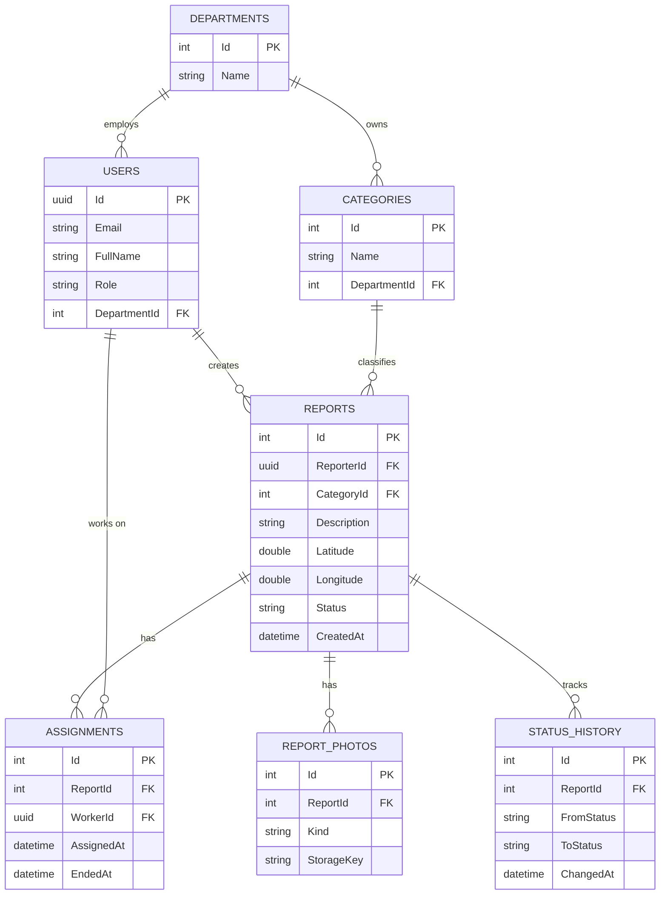

# FixIt: არქიტექტურა

## 1. არქიტექტურული სტილი

**Client-Server**, სადაც სერვერი არის **ფენოვანი მონოლითი** (Layered Monolith). ორი კლიენტია: მობილური აპლიკაცია მოქალაქისა და თანამშრომლისთვის და ვებ-პანელი დისპეჩერისა და ადმინისტრატორისთვის. ორივე ერთ REST API-ს იყენებს.

რატომ:

1. **მომხმარებლები სხვადასხვა მოწყობილობით მუშაობენ.** მოქალაქეს და თანამშრომელს სჭირდებათ კამერა და GPS, ამიტომ მათთვის მობილური აპი ჯობს. დისპეჩერი კომპიუტერთან ზის და მას ცხრილები და ფილტრები სჭირდება, ამიტომ ვები ჯობს.
2. **ერთი სერვერი, ერთი ლოგიკა.** სტატუსის და მინიჭების წესები ერთ ადგილას წერია, ორივე კლიენტი ერთსა და იმავე წესებს იყენებს.
3. **ერთი ადამიანისთვის მართვადია.** მიკროსერვისები ერთ სემესტრში ზედმეტი სირთულე იქნებოდა: ცალკე deploy, სერვისებს შორის კავშირი, განაწილებული ტრანზაქციები.

## 2. კომპონენტების დიაგრამა

## 3. Design Patterns

**Backend: Service Layer.** Controller მხოლოდ იღებს მოთხოვნას და აბრუნებს პასუხს. ბიზნესლოგიკა, მაგალითად „განაცხადის მინიჭება შეიძლება მხოლოდ მაშინ, თუ ის ჯერ არ არის დაწყებული“, Service კლასშია (`ReportService`). ასე ლოგიკა ცალკე ტესტდება და Controller-ზე არ არის დამოკიდებული.

**Frontend: MVVM (მობილურ აპში).** ეკრანი (View) მხოლოდ აჩვენებს მონაცემებს. ViewModel-ის როლს ასრულებს React hook (მაგ. `useMyReports`), რომელიც API-ს იძახებს და ინახავს loading, error და მონაცემებს. ვებ-პანელიც იგივე პრინციპით არის აწყობილი.

## 4. API

| Method | Endpoint | ვინ | რას აკეთებს |
|---|---|---|---|
| POST | `/api/auth/register` | ყველა | მოქალაქის რეგისტრაცია |
| POST | `/api/auth/login` | ყველა | შესვლა |
| POST | `/api/reports` | მოქალაქე | განაცხადის შექმნა (აღწერა, კატეგორია, კოორდინატები, 1-3 ფოტო) |
| GET | `/api/reports/mine` | მოქალაქე | ჩემი განაცხადები და სტატუსები |
| GET | `/api/manager/reports?status=New` | მენეჯერი | უწყების განაცხადები ფილტრით |
| POST | `/api/manager/reports/{id}/assign` | მენეჯერი | თანამშრომლის მინიჭება |
| PATCH | `/api/worker/tasks/{id}/start` | თანამშრომელი | სამუშაოს დაწყება |
| POST | `/api/worker/tasks/{id}/complete` | თანამშრომელი | დასრულება ფოტოთი |

შეცდომისას API აბრუნებს სტანდარტულ კოდებს: 400 (არასწორი მონაცემები), 401/403 (წვდომა), 404 (არ არსებობს), 409 (დაუშვებელი სტატუსის ცვლილება).

## 5. მონაცემთა ბაზა

**SQL, PostgreSQL.** მონაცემები ერთმანეთთან მჭიდროდ არის დაკავშირებული: განაცხადს ჰყავს ავტორი, აქვს კატეგორია, ფოტოები და მინიჭებები. ამისთვის საჭიროა Foreign Key-ები და ტრანზაქციები, რაც რელაციური ბაზის ძლიერი მხარეა. მუნიციპალიტეტის საზღვრის შესამოწმებლად გამოიყენება PostGIS (PostgreSQL-ის გაფართოება).

**სტატუსები:** `New` → `Accepted` (მინიჭებულია) → `InProgress` → `Resolved`. `New`-იდან შესაძლებელია `Rejected`. სხვა გადასვლა აკრძალულია. სტატუსის ყოველი ცვლილება იწერება `STATUS_HISTORY`-ში.

## 6. ტექნოლოგიური სტეკი

| ნაწილი | ტექნოლოგია |
|---|---|
| მობილური აპი | React Native + Expo (TypeScript) |
| ვებ-პანელი | Next.js (TypeScript) |
| სერვერი | ASP.NET Core Web API (C#), EF Core |
| ბაზა | PostgreSQL + PostGIS |
| ტესტები | xUnit, Coverlet (coverage) |
| CI და ჰოსტინგი | GitHub Actions, Azure |

NFR-02 (99.9%)-ისთვის სერვერი Azure App Service-ზე იქნება (SLA 99.95%), ბაზა კი PostgreSQL Flexible Server-ზე high availability-ით (SLA 99.95%). ორივე ერთად ≈ 99.9% იძლევა. უფასო გეგმებს SLA არ აქვს.

## 7. რისკები

| რისკი | რას ვაკეთებთ |
|---|---|
| ერთი ადამიანი წერს სამ ნაწილს (API, ვები, მობილური) და შეიძლება დრო არ ეყოს | MVP მხოლოდ Must have-ია; პირველი სპრინტის შემდეგ ვამოწმებ სიჩქარეს და საჭიროების შემთხვევაში ვამცირებ ფარგლებს |
| GPS-მა შეიძლება არასწორი ადგილი აჩვენოს | მოქალაქეს შეუძლია წერტილი რუკაზე ხელით გაასწოროს |
| ფოტოში შეიძლება იყოს პერსონალური მონაცემები (მდებარეობა EXIF-ში) | EXIF იშლება შენახვამდე, ფოტოები საჯაროდ არ ჩანს |
