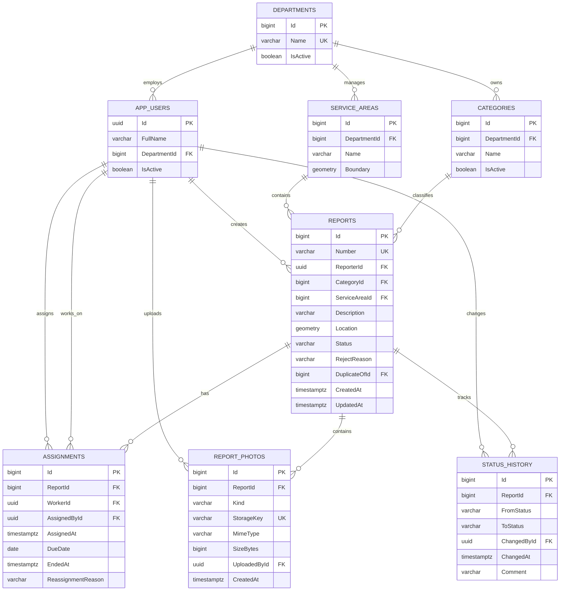

# FixIt — Database Design

**Database:** PostgreSQL  
**Spatial extension:** PostGIS  
**ORM:** Entity Framework Core 10 + Npgsql + NetTopologySuite

## 1. რატომ PostgreSQL?

FixIt-ის მონაცემები რელაციურად არის დაკავშირებული: მომხმარებელი ქმნის Report-ს; Report-ს აქვს Category და ServiceArea; Report-ს შეიძლება ჰქონდეს რამდენიმე Assignment, Photo და StatusHistory ჩანაწერი. ეს მოითხოვს Foreign Key-ებს, უნიკალურ/შემოწმების შეზღუდვებსა და ტრანზაქციებს. PostgreSQL ამას უზრუნველყოფს.

PostGIS გამოიყენება მხოლოდ იქ, სადაც გეოგრაფიული ოპერაცია რეალურ ღირებულებას ქმნის: წერტილი არის თუ არა მუნიციპალურ არეალში და რომელი ჩანაწერები ხვდება რუკის bounding box-ში. EF Core-ში სივრცითი ტიპების რუკირებისთვის გამოიყენება NetTopologySuite.

## 2. ძირითადი ცხრილები

Identity-ისთვის ვიყენებთ ASP.NET Core Identity-ის სტანდარტულ ცხრილებს (`AspNetUsers`, `AspNetRoles`, `AspNetUserRoles` და სხვ.). `AppUser` აფართოებს IdentityUser-ს `FullName`, `DepartmentId`, `IsActive` ველებით.

| ცხრილი | ძირითადი ველები | დანიშნულება |
|---|---|---|
| AspNetUsers / AspNetRoles / AspNetUserRoles | Id, Email, PasswordHash, RoleId… | ანგარიშები და როლები; პაროლი ღია ტექსტით არასოდეს ინახება |
| Departments | Id, Name, IsActive | მუნიციპალური უწყებები |
| Categories | Id, DepartmentId, Name, IsActive | პრობლემის კატეგორიები და პასუხისმგებელი უწყება |
| ServiceAreas | Id, DepartmentId, Name, Boundary | მომსახურების გეოგრაფიული საზღვარი (`geometry(MultiPolygon,4326)`) |
| Reports | Id, Number, ReporterId, CategoryId, ServiceAreaId, Description, Location, Status, CreatedAt, UpdatedAt, RejectReason, DuplicateOfId | მოქალაქის განაცხადი; Location არის `geometry(Point,4326)` |
| Assignments | Id, ReportId, WorkerId, AssignedById, AssignedAt, DueDate, EndedAt, ReassignmentReason | მინიჭების სრული ისტორია; ერთ Report-ს მაქსიმუმ ერთი აქტიური Assignment აქვს |
| ReportPhotos | Id, ReportId, Kind, StorageKey, MimeType, SizeBytes, UploadedById, CreatedAt | Submission/Completion ფოტოს მეტამონაცემები |
| StatusHistory | Id, ReportId, FromStatus, ToStatus, ChangedById, ChangedAt, Comment | ყველა სტატუსის ცვლილების აუდიტი |
| ReportRatings (future) | Id, ReportId, CitizenId, Rating, Comment, CreatedAt | US-16 შეფასება; MVP-ში არ არის აუცილებელი |
| ReportSupports (future) | ReportId, CitizenId, CreatedAt | US-07 მხარდაჭერა; MVP-ში არ არის აუცილებელი |
| ReopenRequests (future) | Id, ReportId, RequestedById, Reason, Status, ReviewedById, ReviewedAt | US-20 ხელახლა გახსნის მოთხოვნა; Report სტატუსს უშუალოდ არ ცვლის მოთხოვნის შექმნისას |

## 3. ER Diagram



## 4. მნიშვნელოვანი მონაცემთა წესები

1. `Reports.Number` უნიკალურია (მაგ. `FX-2026-001042`).
2. `Categories.DepartmentId` სავალდებულოა; Category-ის Department-მა განსაზღვროს შესაბამისი Manager/Worker scope.
3. `Reports.Location` არის Point, SRID 4326. NetTopologySuite Point-ის X = Longitude, Y = Latitude. API-ის latitude/longitude mapping ამ წესს მკაფიოდ უნდა იცავდეს. Geofence შემოწმებისთვის გამოიყენე `ST_Covers`, რათა ServiceArea-ს საზღვარზე მდებარე წერტილიც დასაშვებად ჩაითვალოს.
4. `Reports.Location` უნდა მოხვდეს შესაბამის `ServiceAreas.Boundary`-ში; შემოწმება სერვერზე PostGIS-ით სრულდება, არა მხოლოდ მობილური რუკის UI-ში.
5. `Assignments`-ში ერთ Report-ზე ერთდროულად მაქსიმუმ ერთი აქტიური მინიჭება შეიძლება. PostgreSQL partial unique index: `UNIQUE (ReportId) WHERE EndedAt IS NULL`.
6. ხელახალი მინიჭება დაშვებულია მხოლოდ Report-ის `Accepted` სტატუსში. ძველი Assignment იხურება, ახალი იქმნება და მიზეზი ინახება. `InProgress`/`Resolved`-ზე მინიჭება აკრძალულია MVP-ში.
7. `ReportPhotos.Kind` იღებს `Submission` ან `Completion` მნიშვნელობას. `Resolved`-ზე გადასვლამდე იმავე Report-ს უნდა ჰქონდეს მინიმუმ ერთი ვალიდური `Completion` ფოტო.
8. `StatusHistory` ჩანაწერი სტატუსის ცვლილებასთან ერთად იმავე DB transaction-ში ინახება.
9. `Rating` თუ არსებობს, არის 1–5 დიაპაზონში.
10. პირადი მონაცემები/StorageKey არ უნდა გამოჩნდეს Public map DTO-ში.

## 5. ფოტოების შენახვის მოდელი

- ბინარული ფაილი ინახება private S3-compatible Object Storage-ში.
- PostgreSQL ინახავს მხოლოდ `StorageKey`, `MimeType`, `SizeBytes`, `Kind`, `UploadedById`, `CreatedAt`.
- ფაილი მოწმდება რეალური image decoder/magic bytes-ით; მხოლოდ extension/MIME header საკმარისი არ არის.
- EXIF metadata იშლება შენახვამდე.
- Storage და PostgreSQL ერთი ACID ტრანზაქცია არ არის: upload → DB transaction; DB ჩავარდნისას storage delete compensation; დამატებით scheduled orphan cleanup.
- ფაილის ჩამოტვირთვა ხდება ავტორიზებული endpoint-ით ან მოკლევადიანი signed URL-ით.

## 6. ინდექსები

- `Reports(Number)` UNIQUE.
- `Reports(ReporterId, CreatedAt DESC)` — Citizen-ის სია.
- `Reports(Status, CategoryId, CreatedAt DESC)` — Manager ფილტრები.
- `Assignments(WorkerId, DueDate)` WHERE `EndedAt IS NULL` — Worker-ის ამოცანები.
- `Assignments(ReportId)` UNIQUE WHERE `EndedAt IS NULL` — ერთი აქტიური მინიჭება.
- `StatusHistory(ReportId, ChangedAt)` — ისტორია.
- `Categories(DepartmentId, IsActive)` — კატეგორიები.
- `ServiceAreas.Boundary` და `Reports.Location` — GiST spatial indexes.

## 7. MVP და Future scope

MVP ცხრილები: Identity tables, Departments, Categories, ServiceAreas, Reports, Assignments, ReportPhotos, StatusHistory.  
Future: ReportRatings, ReportSupports, ReopenRequests და დამატებითი analytics projection-ები.

ამგვარად, მონაცემთა მოდელი არ აიძულებს MVP-ს დაუყოვნებლივ განახორციელოს Could Have ფუნქციონალი.


## 8. SQL Schema Outline (MVP)

ქვემოთ მოცემულია ძირითადი ბიზნესცხრილების სქემატური DDL. Identity-ის `AspNetUsers`/Role ცხრილები იქმნება ASP.NET Core Identity migration-ით; აქ მათი ID ტიპი ნავარაუდებია `uuid`.

```sql
CREATE EXTENSION IF NOT EXISTS postgis;

CREATE TABLE departments (
  id bigint GENERATED ALWAYS AS IDENTITY PRIMARY KEY,
  name varchar(120) NOT NULL UNIQUE,
  is_active boolean NOT NULL DEFAULT true
);

CREATE TABLE categories (
  id bigint GENERATED ALWAYS AS IDENTITY PRIMARY KEY,
  department_id bigint NOT NULL REFERENCES departments(id),
  name varchar(120) NOT NULL,
  is_active boolean NOT NULL DEFAULT true,
  UNIQUE (department_id, name)
);

CREATE TABLE service_areas (
  id bigint GENERATED ALWAYS AS IDENTITY PRIMARY KEY,
  department_id bigint NOT NULL REFERENCES departments(id),
  name varchar(120) NOT NULL,
  boundary geometry(MultiPolygon, 4326) NOT NULL
);

CREATE TABLE reports (
  id bigint GENERATED ALWAYS AS IDENTITY PRIMARY KEY,
  number varchar(32) NOT NULL UNIQUE,
  reporter_id uuid NOT NULL REFERENCES "AspNetUsers"("Id"),
  category_id bigint NOT NULL REFERENCES categories(id),
  service_area_id bigint NOT NULL REFERENCES service_areas(id),
  description varchar(500) NOT NULL,
  location geometry(Point, 4326) NOT NULL,
  status varchar(24) NOT NULL CHECK (status IN
    ('New', 'Accepted', 'InProgress', 'Resolved', 'Rejected', 'Duplicate')),
  reject_reason varchar(500),
  duplicate_of_id bigint REFERENCES reports(id),
  created_at timestamptz NOT NULL DEFAULT now(),
  updated_at timestamptz NOT NULL DEFAULT now()
);

CREATE TABLE assignments (
  id bigint GENERATED ALWAYS AS IDENTITY PRIMARY KEY,
  report_id bigint NOT NULL REFERENCES reports(id),
  worker_id uuid NOT NULL REFERENCES "AspNetUsers"("Id"),
  assigned_by_id uuid NOT NULL REFERENCES "AspNetUsers"("Id"),
  assigned_at timestamptz NOT NULL DEFAULT now(),
  due_date date,
  ended_at timestamptz,
  reassignment_reason varchar(500)
);
CREATE UNIQUE INDEX ux_assignments_one_active_per_report
  ON assignments(report_id) WHERE ended_at IS NULL;

CREATE TABLE report_photos (
  id bigint GENERATED ALWAYS AS IDENTITY PRIMARY KEY,
  report_id bigint NOT NULL REFERENCES reports(id),
  kind varchar(16) NOT NULL CHECK (kind IN ('Submission', 'Completion')),
  storage_key varchar(500) NOT NULL UNIQUE,
  mime_type varchar(100) NOT NULL,
  size_bytes bigint NOT NULL CHECK (size_bytes > 0 AND size_bytes <= 10485760),
  uploaded_by_id uuid NOT NULL REFERENCES "AspNetUsers"("Id"),
  created_at timestamptz NOT NULL DEFAULT now()
);

CREATE TABLE status_history (
  id bigint GENERATED ALWAYS AS IDENTITY PRIMARY KEY,
  report_id bigint NOT NULL REFERENCES reports(id),
  from_status varchar(24),
  to_status varchar(24) NOT NULL,
  changed_by_id uuid REFERENCES "AspNetUsers"("Id"),
  changed_at timestamptz NOT NULL DEFAULT now(),
  comment varchar(500)
);

CREATE INDEX ix_reports_location ON reports USING gist(location);
CREATE INDEX ix_service_areas_boundary ON service_areas USING gist(boundary);
CREATE INDEX ix_reports_reporter_created ON reports(reporter_id, created_at DESC);
CREATE INDEX ix_reports_status_category_created ON reports(status, category_id, created_at DESC);
CREATE INDEX ix_assignments_worker_due_active ON assignments(worker_id, due_date)
  WHERE ended_at IS NULL;
CREATE INDEX ix_status_history_report_changed ON status_history(report_id, changed_at);
```

**Geofence validation:** Report-ის წერტილი სერვერზე მოწმდება `ST_Covers(service_areas.boundary, reports.location)` ან შესაბამისი spatial predicate-ით. `ST_Covers` საზღვარზე მდებარე წერტილსაც მოიცავს; საბოლოო business rule უნდა შეთანხმდეს მუნიციპალიტეტის საზღვრის მონაცემთან.

DDL არის საწყისი schema outline და საჭიროებს რეალურ Identity table naming/column mapping-სთან, EF Core configuration-სა და migration-ებთან საბოლოო შეთანხმებას.
