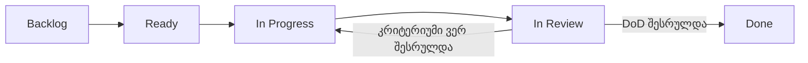

# FixIt — Agile + Kanban Workflow

## 1. მართვის მიდგომა

FixIt იყენებს Agile-ს როგორც განვითარების საერთო მიდგომას და Kanban-ს როგორც სამუშაო ნაკადის მართვის მეთოდს. Agile გვაძლევს ეტაპობრივ მიწოდებასა და უკუკავშირზე რეაგირებას; Kanban კი ვიზუალურად აჩვენებს თითოეული Story-ის მდგომარეობას და ზღუდავს ერთდროულად დაწყებულ სამუშაოს.

ეს ინდივიდუალური პროექტია, ამიტომ Scrum-ის ფიქსირებული Sprint-ები და ყოველდღიური ცერემონიები აუცილებელი არ არის. Backlog შეიძლება განახლდეს სამუშაოს მიმდინარეობისას, ხოლო შესრულება უწყვეტ ნაკადად იმართება.

## 2. GitHub Project

Project: https://github.com/users/gigigiorgadze10/projects/1  
Repository: https://github.com/gigigiorgadze10/fixit

### Status

| Status | განმარტება |
|---|---|
| Backlog | დაგეგმილია, მაგრამ ჯერ დასაწყებად არ შეგვირჩევია ან დამოკიდებულება აკლია |
| Ready | მოთხოვნა გასაგებია, Acceptance Criteria შემოწმებადია და დამოკიდებულებები ცნობილია |
| In Progress | აქტიური შესრულება მიმდინარეობს |
| In Review | ცვლილება მოწმდება Acceptance Criteria-ს, ტესტებისა და უსაფრთხოების მიხედვით |
| Done | ყველა Definition of Done კრიტერიუმი დაკმაყოფილებულია |

### Project Fields

| Field | Type | Values |
|---|---|---|
| Status | Single Select | Backlog, Ready, In Progress, In Review, Done |
| MoSCoW | Single Select | Must Have, Should Have, Could Have, Won't Have (this time) |
| Story Points | Number | 1, 2, 3, 5, 8, 13 |
| Assignees | Built-in | პასუხისმგებელი პირი |
| Labels | Built-in | user-story, must-have, mobile-app, web-dashboard, backend-api და role labels |

MoSCoW პრიორიტეტი და Status სხვადასხვა კითხვას პასუხობს: MoSCoW — რამდენად მნიშვნელოვანია Story; Status — რა ეტაპზეა მისი შესრულება.

## 3. Views

1. **Kanban Board** — Group by `Status`; ყოველდღიური სამუშაოს მართვა.
2. **Product Backlog** — Table View; Group by `MoSCoW`; აჩვენებს Title, Status, Story Points, Assignees და Labels.
3. **MVP View** — ფილტრი `MoSCoW = Must Have`; MVP-ის 10 Story / 39 SP.
4. **Future Scope** — Should/Could/Won't კატეგორიები.

## 4. WIP Limits

ინდივიდუალური მუშაობისთვის:

- `In Progress`: მაქსიმუმ 1 Story.
- `In Review`: მაქსიმუმ 2 Story.

თუ In Review-ში დაგროვდა სამუშაო, ახალი Story-ის დაწყებამდე ჯერ შემოწმება და დასრულება უნდა მოხდეს.

## 5. Definition of Ready

Story გადადის Ready-ში, როდესაც:

- აქვს User Story ფორმატი და ღირებულება კონკრეტული როლისთვის;
- აქვს Given/When/Then Acceptance Criteria;
- მინიჭებული აქვს MoSCoW და Fibonacci Story Points;
- ცნობილია ტექნიკური/ბიზნეს დამოკიდებულებები;
- საკმარისად მცირეა და დასრულების შედეგი შემოწმებადია;
- საჭირო API/UX/მონაცემთა კონტრაქტი გასაგებია.

## 6. სამუშაოს ნაკადი

`Done` არ ნიშნავს მხოლოდ კოდის დაწერას. საჭიროა Acceptance Criteria, ტესტები, review, უსაფრთხოების შემოწმება და დოკუმენტაციის განახლება.

## 7. MVP-ის მართვა

MVP მოიცავს 10 Must Have Story-ს / 39 SP-ს:

`US-01, US-02, US-03, US-04, US-08, US-09, US-11, US-12, US-13, US-18`.

ყველა Must Have თავდაპირველად Backlog-ში რჩება. Mobile-First არქიტექტურის გამო **US-18** არის პირველი ტექნიკური foundation Story და მისი დასრულების/Ready შეფასების შემდეგ იწყება US-01. შემდეგ Story-ები გადადის Ready-ში დამოკიდებულებებისა და რეალური შესაძლებლობის მიხედვით. MoSCoW = Must Have ავტომატურად Ready-ს არ ნიშნავს.

## 8. Backlog Refinement

კვირაში ერთხელ გადაიხედოს:

- დასრულებული Story-ები და დარჩენილი Must Have ქულები;
- დაბლოკილი/გაურკვეველი Story-ები;
- Story Points-ის შეფასებები;
- Mobile, Web და Backend-ის ტექნიკური დამოკიდებულებები;
- ახალი მოთხოვნები, რომლებიც MVP-ის ფარგლებს არ უნდა გასცდეს.

## 9. რეკომენდებული Labels

- საერთო: `user-story`, `must-have`, `should-have`, `could-have`, `wont-have`;
- კლიენტი: `mobile-app`, `web-dashboard`;
- სერვერი: `backend-api`, `database`, `security`, `file-storage`;
- როლები: `role: მოქალაქე`, `role: მენეჯერი`, `role: თანამშრომელი`, `role: ადმინი`.
