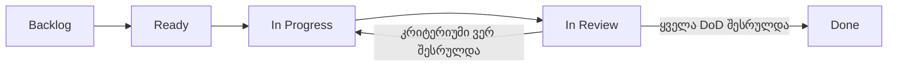

# FixIt — Agile + Kanban Workflow

## 1. მართვის მიდგომა

FixIt-ისთვის გამოყენებულია **Agile როგორც განვითარების საერთო მიდგომა და Kanban როგორც სამუშაო პროცესის მართვის მეთოდი**.

Agile უზრუნველყოფს ეტაპობრივ მიწოდებას, უკუკავშირის მიღებასა და მოთხოვნების ცვლილებებთან ადაპტაციას. Kanban აჩვენებს თითოეული User Story-ის მიმდინარე მდგომარეობას, ზღუდავს ერთდროულად დაწყებულ სამუშაოს და ეხმარება გუნდს დავალებების უწყვეტად დასრულებაში.

FixIt-ის ინდივიდუალური Backlog-ისთვის Kanban უფრო მარტივია, ვიდრე Sprint-ებზე დაფუძნებული Scrum გეგმა: სამუშაოს მოცულობა და თანმიმდევრობა შეიძლება შეიცვალოს Sprint-ის საზღვრების გადაკეთების გარეშე.

## 2. GitHub Project

Project: https://github.com/users/gigigiorgadze10/projects/1  
Repository: https://github.com/gigigiorgadze10/fixit

### Board Status

| Status | განმარტება | როდის გამოიყენება |
|---|---|---|
| Backlog | დაგეგმილი, მაგრამ ჯერ დასაწყებად არჩეული სამუშაო | ყველა ახალი Issue თავდაპირველად აქ არის. |
| Ready | მოთხოვნა დაზუსტებულია და ყველა მნიშვნელოვანი დამოკიდებულება ცნობილია | Story აკმაყოფილებს Definition of Ready-ს. |
| In Progress | აქტიური შესრულება | რეალურად დაწყებულია კოდის/დოკუმენტის/ტესტის მომზადება. |
| In Review | შესრულებულია და მოწმდება | მოწმდება Acceptance Criteria, ტესტები და კოდის ხარისხი. |
| Done | დასრულებულია | ყველა Definition of Done კრიტერიუმი შესრულებულია. |

### Project Fields

| Field | Type | Options / მნიშვნელობა |
|---|---|---|
| `Status` | Single Select | Backlog, Ready, In Progress, In Review, Done |
| `MoSCoW` | Single Select | Must Have, Should Have, Could Have, Won't Have (this time) |
| `Story Points` | Number | 1, 2, 3, 5, 8, 13 |
| `Assignees` | Built-in | პასუხისმგებელი პირი |
| `Labels` | Built-in | user-story, priority და role labels |

`MoSCoW` გამოყოფილია `Status`-ისგან: პრიორიტეტი უცვლელი შეიძლება იყოს, მაშინაც კი, როცა Story Backlog-იდან Done-მდე გადაადგილდება.

## 3. Views

1. **Kanban Board** — Group by `Status`; ყოველდღიური სამუშაოს მართვა.
2. **Product Backlog** — Table View; Group by `MoSCoW`, აჩვენებს სათაურს, ქულას, სტატუსსა და პასუხისმგებელ პირს.
3. **MVP View** — Table ან Board ფილტრით `MoSCoW = Must Have`.
4. **Future Scope** — ფილტრი `Could Have` ან `Won't Have`.

## 4. WIP Limits — მიმდინარე სამუშაოს შეზღუდვა

ინდივიდუალური მუშაობისას რეკომენდებული საწყისი ლიმიტებია:

- `In Progress`: მაქსიმუმ **1** Story ერთდროულად.
- `In Review`: მაქსიმუმ **2** Story.

თუ Review-ში დაგროვდა სამუშაო, ახალი Story-ის დაწყების ნაცვლად ჯერ არსებული შემოწმება და დასრულება უნდა მოხდეს.

## 5. Definition of Ready

Story `Ready` მდგომარეობაში გადადის მაშინ, როდესაც:

- აქვს User Story ფორმატი და გასაგები მომხმარებლის ღირებულება;
- აქვს Given/When/Then Acceptance Criteria;
- მინიჭებული აქვს MoSCoW პრიორიტეტი და Fibonacci Story Points;
- ცნობილია საჭირო მონაცემები, როლები და გარე დამოკიდებულებები;
- Story საკმარისად მცირეა და მისი დასრულების შედეგი შემოწმებადია.

## 6. სამუშაოს ნაკადი

Story არ გადადის `Done`-ში მხოლოდ იმიტომ, რომ კოდი დაიწერა. საჭიროა Acceptance Criteria-ს, ტესტებისა და Definition of Done-ის შესრულება.

## 7. MVP-ის მართვა

MVP მოიცავს 9 Must Have Story-ს და 31 Story Point-ს:

US-01, US-02, US-03, US-04, US-08, US-09, US-11, US-12 და US-13.

ყველა Must Have Issue თავდაპირველად `Backlog`-ში რჩება. შემდეგ დამოკიდებულებების გათვალისწინებით მხოლოდ შემდეგი ერთი სამუშაო გადადის `Ready`-ში. `MoSCoW = Must Have` ავტომატურად არ ნიშნავს `Ready`-ს.

## 8. Backlog Refinement და პროგრესის შეფასება

კვირაში ერთხელ გადაიხედოს:

- დასრულებული Story-ები და დარჩენილი Must Have ქულები;
- დაბლოკილი ან გაურკვეველი Story-ები;
- Story Points-ის შეფასების სიზუსტე;
- ახალი იდეები, რომლებიც MVP-ის ფარგლებს არ უნდა გასცდეს.

Scrum Sprint, Sprint Planning, Daily Scrum და Sprint Burndown ამ პროექტის არჩეული პროცესის ნაწილი არ არის. ამიტომ Project-ში `Sprint` Iteration ველი და `Sprint Planning` View საჭირო არ არის.

## 9. გამოყენებული Labels

- `user-story`
- `must-have`
- `should-have`
- `could-have`
- `wont-have`
- `role: მოქალაქე`
- `role: მენეჯერი`
- `role: თანამშრომელი`
- `role: ადმინი`

დამატებით შეიძლება `backend`, `frontend`, `database`, `security`, `testing` ტიპის ტექნიკური Labels.
